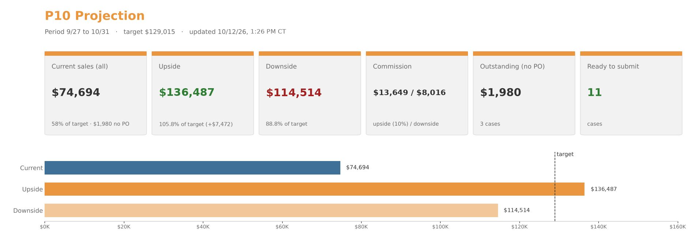
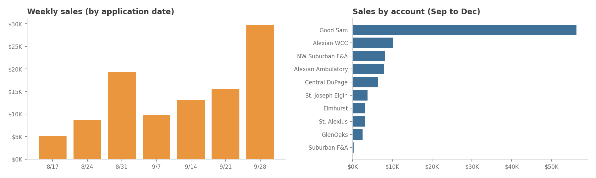

**[⬇ Download the Excel file](https://github.com/ajpeterson113/Graft-Tracker/raw/main/Graft_Tracker_BIOT_Chicago_West.xlsx)**  ·  **[⬇ Patient list](https://github.com/ajpeterson113/Graft-Tracker/raw/main/Chi_West_Patient_List.xlsx)**  ·  updated 10/5/26, 8:41 PM CT · [👥 Patients dashboard](Patients.md)

## October

**🟢 Ready to submit to SFDC:** 1 · **🟡 Waiting on a PO:** 4 · **Submitted, not in SFDC yet:** 14 · **⚪ In SFDC:** 6

### 🟢 Ready to submit to SFDC  (1 · $190.00)

| Date | Pt | Account | Surgeon | Product | Lot/SN | Price | PO |  |
| --- | --- | --- | --- | --- | --- | ---: | --- | --- |
| 9/29 | Y.L. | Suburban F&A | Grinberg | Grafix 16mm | LYA-260138_16034 | $190.00 | YL092926 | [📄](case-sheets/yl-0929.md) |

### 🟡 Waiting on a PO  (4 · $6,690.50)

| Date | Pt | Account | Surgeon | Product | Lot/SN | Price | PO |  |
| --- | --- | --- | --- | --- | --- | ---: | --- | --- |
| 9/16 | A.P. | Alexian WCC | Hussain | Grafix 1.5x2 | LYA-250733_15013 | $600.00 |  | [📄](case-sheets/ap-0916.md) |
| 9/25 | T.W. | St. Joseph Elgin | Bryniczka | Stravix 3x6 | LYU-260572_36001 | $2,615.00 |  | [📄](case-sheets/tw-0925.md) |
| 9/28 | P.C. | Elmhurst | McGann | Stravix 3x6 | LYU-251987_36003 | $3,115.50 |  | [📄](case-sheets/pc-0928.md) |
| 10/2 | V.D. | Alexian WCC | Ramani | Grafix 16mm | LYA-260159_16004 | $360.00 |  | [📄](case-sheets/vd-1002.md) |

### Submitted, not in SFDC yet  (14 · $26,881.35)

| Date | Pt | Account | Surgeon | Product | Lot/SN | Price | PO |  |
| --- | --- | --- | --- | --- | --- | ---: | --- | --- |
| 9/2 | M.D. | Alexian WCC | Hussain | Grafix 16mm | LYA-250856_16011 | $360.00 | …282625 | [📄](case-sheets/md-0902.md) |
| 9/29 | M.L. | Alexian WCC | Joshi | Grafix 16mm | LYA-260138_16032 | $360.00 | …283975 | [📄](case-sheets/ml-0929.md) |
| 9/29 | G.G. | St. Alexius | Goldkind | Stravix 2x4 | LYU-242364_24001 | $1,553.10 | 660080000212141 | [📄](case-sheets/gg-0929.md) |
| 9/29 | D.G. | Alexian WCC | Lucas | Grafix 16mm | LYA-260017_16016 | $360.00 | …283949 | [📄](case-sheets/dg-0929.md) |
| 9/29 | T.T. | Alexian WCC | Lucas | Grafix 16mm | LYA-260138_16031 | $360.00 | …283951 | [📄](case-sheets/tt-0929.md) |
| 9/29 | J.L. | Alexian WCC | Lucas | Grafix 16mm | LYA-260017_16020 | $360.00 | …283950 | [📄](case-sheets/jl-0929.md) |
| 9/30 | A.P. | Alexian WCC | Hussain | Grafix 16mm | LYA-260141_16035 | $360.00 | …284120 | [📄](case-sheets/ap-0930.md) |
| 10/1 | T.A. | Good Sam | Farhan | Stravix 2x4 | LYU-260468_24002 | $1,695.00 | PO005984962 | [📄](case-sheets/ta-1001.md) |
| 10/2 | R.C. | Central DuPage | Luetkehans | Grafix 5x5 ×3 | LYA-260354_55014, LYA-260354_55015, LYA-260328_55005 | $6,375.00 | RC100226 | [📄](case-sheets/rc-1002.md) |
| 10/2 |  | Good Sam |  | Grafix 1.5x2 (x1), 16mm (x4), 3x4 (x2) |  | $4,903.00 | PO005986967 |  |
| 10/2 |  | Good Sam |  | OASIS Ultra 7x10 meshed (1 box of 5) |  | $4,243.75 | PO005986967 |  |
| 10/2 |  | St. Joseph Elgin |  | OASIS Wound Matrix 3x3.5 (10 sheets = 1 box) |  | $1,126.50 | 712062784 |  |
| 10/2 | R.W. | Good Sam | Luetkehans | Grafix 5x5 | LYA-250878_55010 | $2,500.00 | PO005995283 | [📄](case-sheets/rw-1002.md) |
| 10/5 |  | St. Alexius |  | Grafix 5x5 (bill & replace restock, case TBD) |  | $2,325.00 | 660080000212141 |  |

### ⚪ In SFDC  (6 · $4,771.35)

| Date | Pt | Account | Surgeon | Product | Lot/SN | Price | PO |  |
| --- | --- | --- | --- | --- | --- | ---: | --- | --- |
| 9/11 | N.W. | St. Alexius | Bryniczka | Stravix 2x4 | LYU-242364_24002 | $1,553.10 | 660080000211873 | [📄](case-sheets/nw-0911.md) |
| 9/22 | T.T. | Alexian WCC | Lucas | Grafix 1.5x2 | LYA-260066_15012 | $600.00 | …283378 | [📄](case-sheets/tt-0922.md) |
| 9/22 | A.N. | Alexian WCC | Joshi | Grafix 16mm | LYA-260017_16012 | $360.00 | …283433 | [📄](case-sheets/an-0922.md) |
| 9/29 | A.N. | Alexian WCC | Joshi | Grafix 16mm | LYA-260138_16033 | $360.00 | …283952 | [📄](case-sheets/an-0929.md) |
| 9/30 |  | NW Suburban F&A |  | OASIS Ultra 3x3.5 |  | $771.75 | CC100526 |  |
| 9/30 |  | NW Suburban F&A |  | OASIS Wound Matrix 3x3.5 |  | $1,126.50 | EP093026 |  |

### Clinic stock used, no new sale  (1)

| Date | Pt | Account | Surgeon | Product | Lot/SN | Price | PO |  |
| --- | --- | --- | --- | --- | --- | ---: | --- | --- |
| 10/5 | P.S. | NW Suburban F&A | Goldkind | Grafix 16mm | LYA-250894_16005 | – | PS100626 (bought 8/22) | [📄](case-sheets/ps-1005.md) |

**October total $38,533.20** · received $31,842.70 · outstanding $6,690.50

<b>October notes</b>

| Date | Pt | Note |
| --- | --- | --- |
| 9/2 | M.D. | App #5 of 6 (Alexian application log). Graft LYA-250856_16011 applied 9/2; PO ...282625 received 9/14. Case sheet created 10/5 (sticker from the Alexian application log). Not in SFDC yet. Submitted 10/5 |
| 9/11 | N.W. | Bill & replace (St. Alexius): in SFDC as inv 0985785720 on PO 660080000211873 (9/30), billed on replacement unit LYU-242364_24004. Case sheet unit used: LYU-242364_24002. Bill only; L ankle |
| 9/16 | A.P. | App #1 of 3 (10/2 list). No PO yet (Patient ID per Sept tab) |
| 9/22 | T.T. | App #5 of 6 (Alexian application log). In SFDC: inv 0985784425 on PO ...283378 (billing corrected 9/30). Patient ID 0003008184, PS13015 1.5x2 $600 |
| 9/22 | A.N. | App #2 of 3 (10/2 list). In SFDC: inv 0985785270 on PO ...283433. Patient ID 0002817866 = A.N. |
| 9/25 | T.W. |  |
| 9/28 | P.C. |  |
| 9/29 | D.G. | App #2 of 2 (10/2 list). Case sheet on file. PO confirmed: Patient ID 0002861662 = D.G. Submitted 10/5 |
| 9/29 | T.T. | App #6 of 6 (Alexian application log). #7 expected 10/6. Case sheet on file. PO confirmed: Patient ID 0003008184 = T.T. (Sept tab). Submitted 10/5 |
| 9/29 | J.L. | App #1 of 1 (10/2 list). Case sheet on file (initials J.L., not L.J. as on the receiving log). PO by elimination: the other two Lucas 9/29 POs are confirmed to D.G. and T.T. Submitted 10/5 |
| 9/29 | M.L. | App #1 of 1 (10/2 list). PO SWITCHED: now on ...283975 (A.N.'s PO, Patient ID 0002817866) because A.N. was billed on ...283952. Bill M.L. on ...283975 |
| 9/29 | A.N. | App #3 of 3 (10/2 list). PO SWITCHED: billed on ...283952 (inv 0985785272), which was M.L.'s PO (Patient ID 0003052747). A.N.'s own PO ...283975 now sits on M.L. In SFDC |
| 9/29 | Y.L. | PO on case sheet |
| 9/29 | G.G. | Bill & replace (St. Alexius): replacement Stravix 2x4 (PS61024) shipped 10/5 on PO 660080000212141 (same PO as the Grafix 5x5 restock). Case sheet unit used: LYU-242364_24001, $1,553.10. SFDC will show the replacement serial |
| 9/30 | OASIS Ultra 3x3.5 | In SFDC: inv 0985789919, transaction 10/1 (dashboard 10/2). OASIS Ultra 3x3.5 fenestrated, 1 box (ctn 5). Ordered 9/30. Price per account quote. PO CC100526 |
| 9/30 | OASIS Wound Matrix 3x3.5 | In SFDC: inv 0985789918, transaction 10/1 (dashboard 10/2). OASIS Wound Matrix 3x3.5, 1 box (ctn 10). Ordered 9/30. Price per account quote. PO EP093026 |
| 9/30 | A.P. | App #3 of 3 (10/2 list). PO ...284120 confirmed: Patient ID 0003068368 = A.P., DOS 9/30, PS13016 16mm $360. Submitted 10/5 |
| 10/1 | T.A. | PO005984962 approved 10/2 (Owens & Minor, OR, Dr. Farhan). Stravix 2x4 LYU-260468_24002, $1,695. Submitted 10/5 |
| 10/2 | R.C. | 3 x 5x5 (3 x $2,125.00), patient R.C., submitted to SFDC on PO RC100226 (4 were ordered for the 10/2 visit). Case sheet on file: LYA-260354_55014 (exp 4/22/28), LYA-260354_55015 (exp 4/22/28), LYA-260328_55005 (exp 3/20/28) |
| 10/2 | R.W. | OR case at Good Sam (not a recurring graft patient). PO005995283 approved 10/5 (Owens & Minor, OR, Dr. Luetkehans; Lot/SN LYA-250878_55010 matches), $2,500. Submitted 10/5 |
| 10/2 | Grafix 1.5x2 (x1), 16mm (x4), 3x4 (x2) | 7-piece stock order shipped 10/2 (FedEx 519100056924): 1.5x2 x1 $780 + 16mm x4 $425.50 + 3x4 x2 $1,210.50 = $4,903. PO-only, no case sheet; serials not on the shipping report. Shipped order, invoices on its own |
| 10/2 | OASIS Ultra 7x10 meshed (1 box of 5) | OASIS Ultra 7x10 meshed, 1 box of 5 sheets, shipped 10/2 (FedEx 534747002230) on PO005986967. Good Sam box price $4,243.75. OASIS is bought by the box |
| 10/2 | OASIS Wound Matrix 3x3.5 (10 sheets = 1 box) | OASIS Wound Matrix 3x3.5: report QTY 10 = 10 sheets = 1 box (10 per box), shipped 10/2 on PO 712062784. Elgin box price $1,126.50 |
| 10/2 | V.D. | App #6. Case sheet corrected to 10/2/26 (regenerated from the template with the sticker photo). Down to 16mm (was 1.5x2). Waiting on the Alexian PO |
| 10/5 | P.S. | App #1. PO PS100626: NWSFA bought this 16mm 8/22/26 (clinic stock), so it is not an October sale (case sheet shows $190.00). Weekly 16mm orders start 10/12 |
| 10/5 | Grafix 5x5 (St. Alexius) | Bill & replace restock shipped 10/5 on PO 660080000212141 (with G.G.'s Stravix). Case details not known yet (patient, surgeon, date of service, lot/SN). Dated by ship date until the case sheet is in. $2,325 |

## Projection

|  | Upside | Downside |
| --- | ---: | ---: |
| Current October sales | $38,533.20 | $38,533.20 |
| + Projected Grafix, net of WCC stock | $71,715.00 | $54,652.50 |
| + Upcoming Stravix | $4,938.00 | $4,938.00 |
| + Potential new starts (upside only) | $0.00 | $0.00 |
| + OASIS reorders (estimated) | $9,314.23 | $2,967.95 |
| **Projected P10 total** | **$124,500.43** | **$101,091.65** |
| P10 target | $129,015.00 | $129,015.00 |
| % of target | 96.5% | 78.4% |
| Gap to target | $4,514.57 | $27,923.35 |
| **Projected commission** | **$8,715.03** | **$7,076.42** |

Projected visits start 10/5; sold amounts come from the October tab.

### By account

| Account | Sold | Projected upside | Projected downside | P10 upside | P10 downside |
| --- | ---: | ---: | ---: | ---: | ---: |
| Good Sam | $13,341.75 | $33,555.00 | $24,722.50 | **$46,896.75** | **$38,064.25** |
| Central DuPage | $6,375.00 | $25,500.00 | $21,080.00 | **$31,875.00** | **$27,455.00** |
| Alexian WCC | $4,440.00 | $17,037.73 | $10,121.45 | **$21,477.73** | **$14,561.45** |
| St. Alexius | $5,431.20 | $4,938.00 | $4,938.00 | **$10,369.20** | **$10,369.20** |
| NW Suburban F&A | $1,898.25 | $4,366.50 | $1,696.50 | **$6,264.75** | **$3,594.75** |
| St. Joseph Elgin | $3,741.50 | $0.00 | $0.00 | **$3,741.50** | **$3,741.50** |
| Elmhurst | $3,115.50 | $0.00 | $0.00 | **$3,115.50** | **$3,115.50** |
| Suburban F&A | $190.00 | $570.00 | $0.00 | **$760.00** | **$190.00** |
| Alexian Ambulatory | $0.00 | $0.00 | $0.00 | **$0.00** | **$0.00** |
| Sherman | $0.00 | $0.00 | $0.00 | **$0.00** | **$0.00** |
| GlenOaks | $0.00 | $0.00 | $0.00 | **$0.00** | **$0.00** |
| **Total** | **$38,533.20** | **$85,967.23** | **$62,558.45** | **$124,500.43** | **$101,091.65** |

<b>Projection by patient</b>

| Account | Surgeon | Pt | Units × size | Freq | Apps | Visits | Upside | Downside change | Downside |
| --- | --- | --- | --- | --- | --- | --- | ---: | --- | ---: |
| Good Sam | Bach | C.H. | 1× 5x5 | Weekly | 0 | 4 | $10,000.00 | 5x5 × 2 | $5,000.00 |
| Good Sam | Ayesh | W.K. | 1× 16mm | Biweekly | 5 | 2 | $851.00 | 16mm × 1 | $425.50 |
| Good Sam | Ayesh | K.P. | 1× 5x5 | Biweekly | 6 | 2 | $5,000.00 | 3x4 × 2 | $2,421.00 |
| Good Sam | Ayesh | K.P. | 1× 3x4 | Biweekly | 6 | 2 | $2,421.00 | 3x3 × 2 | $2,231.00 |
| Good Sam | Ayesh | C.B. | 1× 3x4 | Once | 3 | 0 | $0.00 | same | $0.00 |
| Good Sam | Ayesh | C.B. | 1× 2x3 | Biweekly | 3 | 2 | $1,960.00 | same | $1,960.00 |
| Good Sam | Luetkehans | P.J. | 3× 16mm | Weekly | 2 | 4 | $5,106.00 | same | $5,106.00 |
| Good Sam | Luetkehans | D.F. | 1× 5x5 | Weekly | 0 | 4 | $10,000.00 | same | $10,000.00 |
| Good Sam | Luetkehans | L.D. | 1× 1.5x2 | Weekly | 22 | 4 | $3,120.00 | 16mm × 4 | $1,702.00 |
| Alexian WCC | Lucas | T.T. | 1× 16mm | Weekly | 6 | 4 | $1,440.00 | 16mm × 1 | $360.00 |
| Alexian WCC | Lucas | D.G. | 1× 16mm | Weekly | 2 | 4 | $1,440.00 | same | $1,440.00 |
| Alexian WCC | Lucas | J.L. | 1× 16mm | Weekly | 1 | 4 | $1,440.00 | same | $1,440.00 |
| Alexian WCC | Joshi | M.L. | 1× 16mm | Weekly | 1 | 4 | $1,440.00 | same | $1,440.00 |
| Alexian WCC | Joshi | A.N. | 1× 16mm | Weekly | 3 | 4 | $1,440.00 | same | $1,440.00 |
| Alexian WCC | Adelstein | D.C. | 1× 16mm | Weekly | 5 | 4 | $1,440.00 | 16mm × 1 | $360.00 |
| Alexian WCC | Hussain | A.P. | 1× 16mm | Weekly | 3 | 4 | $1,440.00 | same | $1,440.00 |
| Alexian WCC | Ramani | V.D. | 1× 16mm | Weekly | 6 | 4 | $1,440.00 | 16mm × 1 | $360.00 |
| Central DuPage | Luetkehans | R.C. | 3× 5x5 | Weekly | 1 | 4 | $25,500.00 | 2x 5x5 + 1x 3x4 × 4 | $21,080.00 |
| Suburban F&A | Grinberg | Y.L. | 1× 16mm | Weekly · on hold, back 10/13 | 1 | 3 | $570.00 | stays on hold | $0.00 |
| NW Suburban F&A | Goldkind | P.S. | 1× 16mm | Weekly | 1 | 3 | $570.00 | same | $570.00 |

**Upcoming Stravix**

| Account | Surgeon | Date | Size | Upside | Downside |
| --- | --- | --- | --- | ---: | ---: |
| St. Alexius | Guske | 10/7 | Stravix 3x6 | $2,469.00 | $2,469.00 |
| St. Alexius | Liao | 10/16 | Stravix 3x6 | $2,469.00 | $2,469.00 |
| GlenOaks | Reed | Possible, this week or next | Stravix, size TBD | – | – |

**OASIS reorders (estimated, by the box)**

| Account | Patients | Product | Size | Boxes up | Boxes down | Box price | Upside | Downside |
| --- | --- | --- | --- | ---: | ---: | ---: | ---: | ---: |
| NW Suburban F&A | C.C. (R.D., S.B. on hold) | OASIS Ultra | 3x3.5 | 2 | 0 | $771.75 | $1,543.50 | $0.00 |
| NW Suburban F&A | J.M., P.M., C.T., E.P. | OASIS Wound Matrix | 3x3.5 | 2 | 1 | $1,126.50 | $2,253.00 | $1,126.50 |
| Alexian WCC | D.V. (new start 10/7) | OASIS Wound Matrix | 3x7 | 1 | 0 | $2,206.00 | $2,206.00 | $0.00 |
| Alexian WCC | J.B. | OASIS Burn Matrix | 3x7 | 1 | 0 | $1,470.28 | $1,470.28 | $0.00 |
| Alexian WCC | B.P. (new start 10/5) | OASIS Burn Matrix | 5x7 meshed | 1 | 1 | $1,841.45 | $1,841.45 | $1,841.45 |
| Alexian WCC | D.S. (M.I. on hold) | OASIS Wound Matrix | 3x3.5 | 0 | 0 | $1,104.00 | $0.00 | $0.00 |

## Alexian WCC stock

Counted 10/3 from shelf photos; Wound 3x7 box of 10 added 10/5 (lot and expiry to come with the photos); 10 × 16mm restock shipped 10/5 (no PO; lot/SN/expiry TBD until unpacked). Grafix on hand drops by itself as Alexian cases are filed (lot + SN). Use per week = active and starting patients at their current size.

**58 Grafix units on hand · $62,051 consignment** · targets: 16mm 10–15, other Grafix sizes 5–10 (a few over is fine)

- 🟠 **16mm at the top of the 10–15 range:** 15 on hand (5 on the shelf + 10 shipped 10/5) for 8 patients a week. This week's visits leave about 7, so plan to order about 8 by Friday to get back to 15.
- 🟠 **8 × 3x4 expire 12/18/26:** no Alexian patient is on 3x4 ($9,120 of consignment).

| Product | Size | REF | On hand | Patients | Use / wk | Weeks left | Runs out (wk of) | Status | Order (boxes) | Next expiry |
| --- | --- | --- | ---: | ---: | ---: | ---: | --- | --- | ---: | --- |
| Grafix | 16mm | PS13016 | 15 | 8 | 8 | 1.9 | 10/12 | 🟢 OK (target 10–15) | – | 11/25/27 |
| Grafix | 1.5x2 | PS13015 | 8 | – | – |  |  | No patients on it (target 5–10) | – | 6/18/27 |
| Grafix | 2x3 | PS13023 | 10 | – | – |  |  | No patients on it (target 5–10) | – | 5/2/27 |
| Grafix | 3x3 | PS13033 | 5 | – | – |  |  | No patients on it (target 5–10) | – | 5/2/27 |
| Grafix | 3x4 | PS13034 | 8 | – | – |  |  | No patients on it (target 5–10) | – | **12/18/26 (8 before use)** |
| Grafix | 5x5 | PS13055 | 12 | – | – |  |  | No patients on it (target 5–10) | – | 11/3/27 |
| OASIS Wound Matrix | 3x3.5 | 8213-1000-33 | 8 sheets | 1 | 1 | 8.0 | 11/30 | 🟢 OK | – | 1/31/28 |
| OASIS Wound Matrix | 3x7 | 8213-1000-37 | 10 sheets | 1 | 2 | 5.0 | 11/9 | 🟢 OK | – | photo pending |
| OASIS Burn Matrix | 3x3.5 | 8213-3000-16 | 3 sheets | – | – |  |  | No patients on it | – | 4/3/28 |
| OASIS Burn Matrix | 3x7 | 8213-3000-18 | 4 sheets | 1 | 1 | 4.0 | 11/2 | 🟢 OK | – | 11/8/27 |
| OASIS Burn Matrix | 5x7 meshed | 8213-3000-13 | 3 sheets | 1 | 1 | 3.0 | 10/26 | 🟢 OK | – | 7/11/27 |

<b>Patients using the WCC stock</b>

| Pt | Surgeon | Product | Size | Per visit | Status | Use / wk | Note |
| --- | --- | --- | --- | ---: | --- | ---: | --- |
| T.T. | Lucas | Grafix | 16mm | 1 | Active | 1 | 6 apps; down to 16mm |
| D.G. | Lucas | Grafix | 16mm | 1 | Active | 1 |  |
| J.L. | Lucas | Grafix | 16mm | 1 | Active | 1 |  |
| A.N. | Joshi | Grafix | 16mm | 1 | Active | 1 |  |
| M.L. | Joshi | Grafix | 16mm | 1 | Active | 1 |  |
| A.P. | Hussain | Grafix | 16mm | 1 | Active | 1 |  |
| D.C. | Adelstein | Grafix | 16mm | 1 | Active | 1 | Down to 16mm as of 9/24 |
| V.D. | Ramani | Grafix | 16mm | 1 | Active | 1 | Down to 16mm as of 10/2 |
| O.O. | V | Grafix | TBD | 1 | Starting | – | Potential new start, first visit 10/6. Size not set yet, so not counted |
| J.C. | Joshi | Grafix | 16mm | 1 | Approved | – | Waiting on Mohs surgery |
| X.S. | Robinson | Grafix | TBD | 1 | Pending | – | IVR not submitted; size not set |
| J.T. | Lucas | Grafix | TBD | 1 | Pending | – | Needs notes for prior auth |
| D.S. | Lucas | OASIS Wound Matrix | 3x3.5 | 1 | Active | 1 |  |
| D.V. | Hussain | OASIS Wound Matrix | 3x7 | 2 | Starting | 2 | Potential new start, first visit 10/7. Patient list says multiple 3x7; 2 per visit is a placeholder |
| J.B. | Adelstein | OASIS Burn Matrix | 3x7 | 1 | Active | 1 |  |
| B.P. | Joshi | OASIS Burn Matrix | 5x7 meshed | 1 | Active | 1 | A1 10/5 from the shelf |
| M.I. | Russo | OASIS Wound Matrix | 3x3.5 | 1 | Hold | – | Paused |

<b>Boxes on the shelf</b>

| Product | Size | Lot | SN / sheets left | Expiry | Status | Flag |
| --- | --- | --- | --- | --- | --- | --- |
| OASIS Wound Matrix | 3x3.5 | LB1741499 | 8 of 10 sheets | 1/31/28 | On shelf |  |
| OASIS Burn Matrix | 3x3.5 | LB1732662 | 3 of 5 sheets | 4/3/28 | On shelf |  |
| OASIS Burn Matrix | 3x7 | LB1732663 | 4 of 5 sheets | 11/8/27 | On shelf |  |
| OASIS Burn Matrix | 5x7 meshed | LB1639811 | 3 of 5 sheets | 7/11/27 | On shelf |  |
| OASIS Wound Matrix | 3x7 | Photo pending | 10 of 10 sheets | pending | On shelf |  |
| Grafix | 16mm | LYA-260159 | 16003 | 1/13/28 | On shelf |  |
| Grafix | 16mm | LYA-260159 | 16001 | 1/13/28 | On shelf |  |
| Grafix | 16mm | LYA-260159 | 16028 | 1/13/28 | On shelf |  |
| Grafix | 16mm | LYA-260159 | 16026 | 1/13/28 | On shelf |  |
| Grafix | 16mm | LYA-260017 | 16014 | 11/25/27 | On shelf |  |
| Grafix | 16mm | TBD (shipped 10/5) |  | TBD | On shelf |  |
| Grafix | 16mm | TBD (shipped 10/5) |  | TBD | On shelf |  |
| Grafix | 16mm | TBD (shipped 10/5) |  | TBD | On shelf |  |
| Grafix | 16mm | TBD (shipped 10/5) |  | TBD | On shelf |  |
| Grafix | 16mm | TBD (shipped 10/5) |  | TBD | On shelf |  |
| Grafix | 16mm | TBD (shipped 10/5) |  | TBD | On shelf |  |
| Grafix | 16mm | TBD (shipped 10/5) |  | TBD | On shelf |  |
| Grafix | 16mm | TBD (shipped 10/5) |  | TBD | On shelf |  |
| Grafix | 16mm | TBD (shipped 10/5) |  | TBD | On shelf |  |
| Grafix | 16mm | TBD (shipped 10/5) |  | TBD | On shelf |  |
| Grafix | 1.5x2 | LYA-260068 | 15003 | 11/25/27 | On shelf |  |
| Grafix | 1.5x2 | LYA-260068 | 15002 | 11/25/27 | On shelf |  |
| Grafix | 1.5x2 | LYA-260068 | 15005 | 11/25/27 | On shelf |  |
| Grafix | 1.5x2 | LYA-250733 | 15011 | 8/12/27 | On shelf |  |
| Grafix | 1.5x2 | LYA-250668 | 15009 | 6/18/27 | On shelf |  |
| Grafix | 1.5x2 | LYA-260108 | 15004 | 1/13/28 | On shelf |  |
| Grafix | 1.5x2 | LYA-260108 | 15005 | 1/13/28 | On shelf |  |
| Grafix | 1.5x2 | LYA-260108 | 15006 | 1/13/28 | On shelf |  |
| Grafix | 2x3 | LYA-250516 | 23003 | 5/2/27 | On shelf |  |
| Grafix | 2x3 | LYA-250516 | 23004 | 5/2/27 | On shelf |  |
| Grafix | 2x3 | LYA-250625 | 23005 | 6/18/27 | On shelf |  |
| Grafix | 2x3 | LYA-250625 | 23013 | 6/18/27 | On shelf |  |
| Grafix | 2x3 | LYA-250558 | 23005 | 6/9/27 | On shelf |  |
| Grafix | 2x3 | LYA-250868 | 23006 | 11/3/27 | On shelf |  |
| Grafix | 2x3 | LYA-250868 | 23005 | 11/3/27 | On shelf |  |
| Grafix | 2x3 | LYA-250866 | 23007 | 11/3/27 | On shelf |  |
| Grafix | 2x3 | LYA-250866 | 23008 | 11/3/27 | On shelf |  |
| Grafix | 2x3 | LYA-250866 | 23002 | 11/3/27 | On shelf |  |
| Grafix | 3x3 | LYA-250742 | 33004 | 8/12/27 | On shelf |  |
| Grafix | 3x3 | LYA-250742 | 33003 | 8/12/27 | On shelf |  |
| Grafix | 3x3 | LYA-250533 | 33005 | 5/2/27 | On shelf |  |
| Grafix | 3x3 | LYA-250533 | 33004 | 5/2/27 | On shelf |  |
| Grafix | 3x3 | LYA-250533 | 33002 | 5/2/27 | On shelf |  |
| Grafix | 3x4 | LYA-250012 | 34013 | 12/18/26 | On shelf | Expires before use |
| Grafix | 3x4 | LYA-250012 | 34012 | 12/18/26 | On shelf | Expires before use |
| Grafix | 3x4 | LYA-250008 | 34012 | 12/18/26 | On shelf | Expires before use |
| Grafix | 3x4 | LYA-250008 | 34013 | 12/18/26 | On shelf | Expires before use |
| Grafix | 3x4 | LYA-250008 | 34002 | 12/18/26 | On shelf | Expires before use |
| Grafix | 3x4 | LYA-250008 | 34005 | 12/18/26 | On shelf | Expires before use |
| Grafix | 3x4 | LYA-250008 | 34004 | 12/18/26 | On shelf | Expires before use |
| Grafix | 3x4 | LYA-250008 | 34006 | 12/18/26 | On shelf | Expires before use |
| Grafix | 5x5 | LYA-250866 | 55009 | 11/3/27 | On shelf |  |
| Grafix | 5x5 | LYA-250866 | 55013 | 11/3/27 | On shelf |  |
| Grafix | 5x5 | LYA-250866 | 55014 | 11/3/27 | On shelf |  |
| Grafix | 5x5 | LYA-250866 | 55015 | 11/3/27 | On shelf |  |
| Grafix | 5x5 | LYA-250866 | 55002 | 11/3/27 | On shelf |  |
| Grafix | 5x5 | LYA-250866 | 55001 | 11/3/27 | On shelf |  |
| Grafix | 5x5 | LYA-260005 | 55010 | 11/25/27 | On shelf |  |
| Grafix | 5x5 | LYA-260005 | 55009 | 11/25/27 | On shelf |  |
| Grafix | 5x5 | LYA-260005 | 55008 | 11/25/27 | On shelf |  |
| Grafix | 5x5 | LYA-260005 | 55013 | 11/25/27 | On shelf |  |
| Grafix | 5x5 | LYA-260005 | 55012 | 11/25/27 | On shelf |  |
| Grafix | 5x5 | LYA-260005 | 55011 | 11/25/27 | On shelf |  |

## Trends

<b>Graft size mix</b>

| Size | Units | Sales | % units | % $ |
| --- | ---: | ---: | ---: | ---: |
| Grafix 16mm | 25 | $9,550.50 | 37% | 12% |
| Grafix 1.5 x 2 | 11 | $7,680.00 | 16% | 9% |
| Grafix 2 x 3 | 2 | $1,850.70 | 3% | 2% |
| Grafix 5 x 5 | 8 | $18,875.00 | 12% | 23% |
| Grafix Prime 2 x 3 | 1 | $925.35 | 1% | 1% |
| Stravix 2 x 4 | 11 | $18,077.40 | 16% | 22% |
| Stravix 3 x 6 | 9 | $24,132.50 | 13% | 30% |

<b>September</b> (35 rows · $65,466.75 · all in SFDC)

| Date | Pt | Account | Product | Lot/SN | Price | PO |  |
| --- | --- | --- | --- | --- | ---: | --- | --- |
| 8/20 | W.L. | Good Sam | Stravix 3x6 | LYU-260196_36003 | $2,655.50 | PO005829470 |  |
| 8/21 | L.B. | Good Sam | Grafix 5x5 | LYA-250872_55015 | $2,500.00 | PO005829472 |  |
| 8/25 | A.V. | Good Sam | Stravix 3x6 (x2), 2x4 (x2) | LYU-260196_36004, LYU-260196_36005, LYU-252135_24001, LYU-252135_24005 | $8,701.00 | PO005829467 |  |
| 8/31 |  | Good Sam | Grafix 1.5x2 | LYA-260051_15015 | $780.00 | PO005813582 |  |
| 8/31 |  | Alexian Ambulatory | OASIS Wound Matrix 3x3.5 |  | $1,104.00 | …281566 |  |
| 9/1 | T.T. | Alexian WCC | Grafix 2x3 | LYA-250512_23003 | $925.35 | …282624 |  |
| 9/1 |  | NW Suburban F&A | OASIS Ultra 5x7 |  | $1,528.00 | CC090826 |  |
| 9/1 |  | NW Suburban F&A | OASIS Ultra 3x7 |  | $1,389.00 | FA090326 |  |
| 9/2 | P.J. | Good Sam | Stravix 2x4 | LYU-260082_24001, LYU-260082_24002, LYU-260082_24003 | $5,085.00 | PO005836345 |  |
| 9/2 |  | NW Suburban F&A | OASIS Ultra 3x3.5 |  | $772.00 | CC090826 |  |
| 9/2 |  | NW Suburban F&A | OASIS Wound Matrix 3x3.5 |  | $1,126.00 | PM090726 |  |
| 9/3 | D.C. | Alexian WCC | Grafix 2x3 | LYA-250516_23001 | $925.35 | …282124 |  |
| 9/4 | J.H. | Good Sam | Stravix 3x6 | LYU-260325_36003, LYU-260325_36005 | $5,311.00 | PO005851419 |  |
| 9/8 | K.P. | Good Sam | Grafix 5x5 | LYA-250872_55012 | $2,500.00 | PO005860026 |  |
| 9/8 |  | Good Sam | Grafix 1.5x2 (x1), 16mm (x2) | LYA-260060_15009, LYA-260088_16017, LYA-260088_? | $1,631.00 | PO005847348 |  |
| 9/10 | D.C. | Alexian WCC | Grafix 1.5x2 | LYA-250746_15003 | $600.00 | …282626 |  |
| 9/11 |  | NW Suburban F&A | OASIS Ultra 3x3.5 |  | $772.00 | MZ091826 |  |
| 9/11 |  | NW Suburban F&A | OASIS Ultra 3x7 |  | $2,778.00 | MZ091826 |  |
| 9/14 |  | Good Sam | Grafix 1.5x2 (x2), 16mm (x1), 5x5 (x2) | LYA-260071_15002, LYA-260071_?, LYA-260108_16012, LYA-250460_55014, LYA-250460_? | $6,985.50 | PO005879507 |  |
| 9/14 |  | NW Suburban F&A | OASIS Wound Matrix 3x7 |  | $-2,251.00 | PM082426 |  |
| 9/15 | A.N. | Alexian WCC | Grafix 16mm | LYA-260017_16022 | $360.00 | …282980 |  |
| 9/15 | T.T. | Alexian WCC | Grafix Prime 2x3 | A250112_23004 | $925.35 | …282979 |  |
| 9/16 | M.D. | Alexian WCC | Grafix 16mm | LYA-260017_16023 | $360.00 | …282981 |  |
| 9/16 |  | Alexian Ambulatory | Stravix 2x4 | LYU-251611_24002 | $1,553.10 | …282833 |  |
| 9/17 | D.C. | Alexian WCC | Grafix 1.5x2 | LYA-250733_15012 | $600.00 | …283163 |  |
| 9/17 |  | Alexian Ambulatory | OASIS Burn Matrix 3x7 |  | $1,470.00 | …282978 |  |
| 9/18 | S.A. | GlenOaks | Stravix 3x6 | LYU-251987_36004 | $2,469.00 | PO-1000841030 |  |
| 9/22 | D.G. | Alexian WCC | Grafix 16mm | LYA-260017_16024 | $360.00 | …283377 | [📄](case-sheets/dg-0922-dashboard.md) |
| 9/23 | A.P. | Alexian WCC | Grafix 1.5x2 | LYA-260068_15004 | $600.00 | …283611 |  |
| 9/23 | L.S. | Alexian Ambulatory | Stravix 2x4 | LYU-250662_24002 | $1,553.10 | …283496 |  |
| 9/24 | D.C. | Alexian WCC | Grafix 16mm | LYA-260017_16015 | $360.00 | …283612 | [📄](case-sheets/dc-0924.md) |
| 9/24 |  | Alexian Ambulatory | OASIS Wound Matrix 3x7 |  | $2,206.00 | …283571 |  |
| 9/25 |  | Good Sam | Grafix 1.5x2 (x1), 16mm (x4) | LYA-260100_15001, LYA-260144_16020, LYA-260144_?, LYA-260144_?, LYA-260144_? | $2,482.00 | PO005944943 |  |
| 9/25 |  | Good Sam | Stravix 2x4 | LYU-260468_24001 | $1,695.00 | PO005943086 |  |
| 9/25 |  | Good Sam | Stravix 3x6 | LYU-260325_36001 | $2,655.50 | PO005872125 |  |

