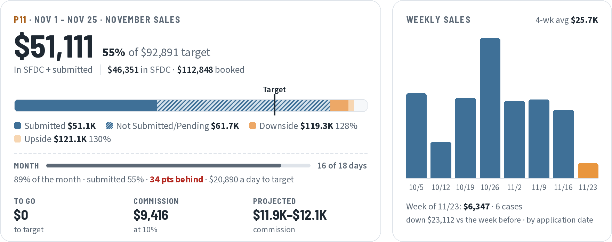

<!-- Generated by tools/site/build_site.py from the tracker and the Chi West Patients app. Edits here are overwritten at the next update: change the script instead. -->

# Graft Tracker

**BIOT Chicago West** · P11 · day 17 of 18 · updated Wed 11/25, 8:12 AM CT

| <ins>**🏠&nbsp;Home**</ins> | [✅&nbsp;To&nbsp;do&nbsp;·&nbsp;24](tracker/todo.md) | [📋&nbsp;Cases](tracker/cases.md) | [📈&nbsp;Projection](tracker/projection.md) | [📦&nbsp;Stock](tracker/stock.md) | [👥&nbsp;Patients](Patients.md) | [🎯&nbsp;Targets](Prospects.md) |
|:-:|:-:|:-:|:-:|:-:|:-:|:-:|

<picture>
  <source media="(max-width: 700px) and (prefers-color-scheme: dark)" srcset="view/home-narrow-dark.png">
  <source media="(max-width: 700px)" srcset="view/home-narrow.png">
  <source media="(prefers-color-scheme: dark)" srcset="view/home-dark.png">
  
</picture>

<b>Commission so far: &#36;9,292.42</b> · 10% on &#36;92,924 in SFDC + submitted

| Counted | Sales | Commission |
| :-- | --: | --: |
| In SFDC | \$46,350.70 | \$4,635.07 |
| Submitted, not in SFDC yet | \$46,573.45 | \$4,657.35 |
| **Total** | **\$92,924.15** | **\$9,292.42** |

10% on everything: target reached, \$33.15 over. POs in hand that are not submitted yet, and cases waiting on a PO, are not counted.

### To do

<table>
<tr>
<td width="50%"><a href="tracker/todo.md#ready"><b>🟢 Ready to submit</b></a> <b>0</b> · &#36;0 to SFDC</td>
<td width="50%"><a href="tracker/todo.md#needspo"><b>🟡 Waiting on a PO</b></a> <b>21</b> · &#36;19,409 outstanding</td>
</tr>
<tr>
<td width="50%"><a href="tracker/todo.md"><b>🔵 Not in SFDC yet</b></a> <b>&#36;67,217</b> · 50 November entries</td>
<td width="50%"><a href="tracker/stock.md"><b>🟠 Stock alerts</b></a> <b>4</b> · Alexian WCC, St. Alexius OR</td>
</tr>
</table>

### This week · Nov 23–27

| [Mon 11/23](patients/week.md#mon) | [Tue 11/24](patients/week.md#tue) | [Wed 11/25 · today](patients/week.md#wed) | [Thu 11/26](patients/week.md#thu) | [Fri 11/27](patients/week.md#fri) |
| :-: | :-: | :-: | :-: | :-: |
| **8** visits | **7** visits 🔴 | **8** visits | **2** visits 🔴 | **5** visits 🔴 |

Covering: Caroline 7 · 🟠 to verify · 🔴 no follow-up booked · [Open the schedule →](patients/week.md)

### P11 forecast

| Account | Sold | Upside | Downside |
| :-- | --: | --: | --: |
| Good Sam | \$26,816 | **\$31,059** | \$31,059 |
| Alexian WCC | \$18,922 | **\$21,373** | \$20,447 |
| NW Suburban F&A | \$12,548 | **\$12,548** | \$12,548 |
| St. Alexius | \$12,345 | **\$12,345** | \$12,345 |
| GlenOaks | \$12,345 | **\$12,345** | \$12,345 |
| Alexian Ambulatory | \$10,064 | **\$10,064** | \$10,064 |
| St. Joseph Elgin | \$8,692 | **\$8,692** | \$7,792 |
| Elmhurst | \$4,883 | **\$4,883** | \$4,883 |
| Romano Lombard | \$2,660 | **\$3,515** | \$3,515 |
| Alexian Main OR | \$2,469 | **\$2,469** | \$2,469 |
| Central DuPage | \$1,210 | **\$1,210** | \$1,210 |
| Sherman | \$426 | **\$426** | \$426 |
| Suburban F&A | \$190 | **\$190** | \$190 |
| **Total** | **\$113,568** | **\$121,118** | **\$119,292** |

Scheduled visits this week count until they're filed; once a visit is in November sales it isn't projected again. [Full projection →](tracker/projection.md)

### 2026 full year

**84%** of \$1,237,893 · \$198,589 to go — \$972,086 in SFDC (11/24) + \$67,217 in this tracker, not in SFDC yet. Through P11: \$1.05M upside / \$1.05M downside (85% / 84%).

<b>By month (SFDC)</b>

| Month | Sales | Target | % of target |
| :-- | --: | --: | --: |
| Jan | \$78,531 | \$80,416 | 98% |
| Feb | \$101,264 | \$91,015 | ✅ 111% |
| Mar | \$98,214 | \$96,468 | ✅ 102% |
| Apr | \$171,853 | \$128,888 | ✅ 133% |
| May | \$86,732 | \$98,773 | 88% |
| Jun | \$65,830 | \$104,206 | 63% |
| Jul | \$102,235 | \$123,929 | 82% |
| Aug | \$62,039 | \$104,285 | 59% |
| Sep | \$65,468 | \$99,804 | 66% |
| Oct / P10 (final, SFDC 11/6) | \$174,896 | \$134,875 | ✅ 130% |
| Nov / P11 (to date, SFDC 11/24) | \$46,351 | \$99,196 | 47% |
| Dec | — | \$126,038 | — |

<b>Periods and payouts</b>

| Period | Dates | Reports | Paid | Commission |
| :-- | :-- | :-- | :-- | --: |
| **P9** | Aug 30 - Sep 26 | 10/26/26 | 11/20/26 | \$4,582.67 |
| **P10** | Sep 27 - Oct 31 | 11/30/26 | 12/18/26 | \$17,489.58 |
| **P11** | Nov 1 - Nov 25 | 1/4/27 | 1/29/27 | \$9,292.41 so far (10%) |
| **P12** | Nov 26 - Dec 31 | 2/1/27 | 2/26/27 | — |

### Files

|  | File | Updated |
| :-: | :-- | :-- |
| ⬇ | [Graft tracker (Excel)](https://github.com/ajpeterson113/Graft-Tracker/raw/main/Graft_Tracker_BIOT_Chicago_West.xlsx) | Graft\_Tracker\_BIOT\_Chicago\_West\_2026-11-25.xlsx · Wed 11/25, 8:09 AM CT |
| ⬇ | [Patient list (Excel)](https://github.com/ajpeterson113/Graft-Tracker/raw/main/Chi_West_Patient_List.xlsx) | from the Chi West Patients app |
| ⬇ | [Target workbook (Excel)](https://github.com/ajpeterson113/Graft-Tracker/raw/main/Chi_West_Surgeon_Targets.xlsx) | surgeon targets |

Same numbers as the Chi West Graft Tracker app. Tip: bookmark [this page](https://github.com/ajpeterson113/Graft-Tracker/blob/main/README.md) to open it without the file list.
