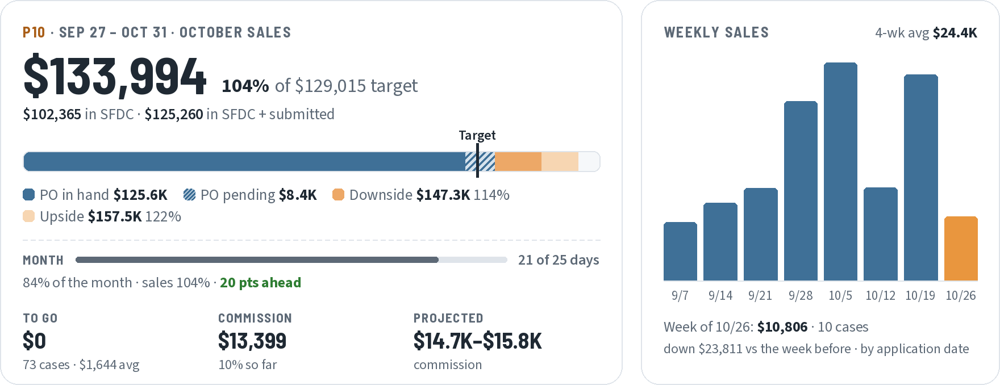

<!-- Generated by tools/site/build_site.py from the tracker and the Chi West Patients app. Edits here are overwritten at the next update: change the script instead. -->

# Graft Tracker

**BIOT Chicago West** · P10 · day 21 of 25 · updated Tue 10/27, 9:09 PM CT

| <ins>**🏠&nbsp;Home**</ins> | [✅&nbsp;To&nbsp;do&nbsp;·&nbsp;8](tracker/todo.md) | [📋&nbsp;Cases](tracker/cases.md) | [📈&nbsp;Projection](tracker/projection.md) | [📦&nbsp;Stock](tracker/stock.md) | [👥&nbsp;Patients](Patients.md) | [🎯&nbsp;Targets](Prospects.md) |
|:-:|:-:|:-:|:-:|:-:|:-:|:-:|

<picture>
  <source media="(max-width: 700px) and (prefers-color-scheme: dark)" srcset="view/home-narrow-dark.png">
  <source media="(max-width: 700px)" srcset="view/home-narrow.png">
  <source media="(prefers-color-scheme: dark)" srcset="view/home-dark.png">
  
</picture>

### To do

<table>
<tr>
<td width="50%"><a href="tracker/todo.md#ready"><b>🟢 Ready to submit</b></a> <b>2</b> · &#36;380 to SFDC</td>
<td width="50%"><a href="tracker/todo.md#needspo"><b>🟡 Waiting on a PO</b></a> <b>6</b> · &#36;8,355 outstanding</td>
</tr>
<tr>
<td width="50%"><a href="tracker/todo.md"><b>🔵 Not in SFDC yet</b></a> <b>&#36;31,629</b> · 34 October entries</td>
<td width="50%"><a href="tracker/stock.md"><b>🟠 Stock alerts</b></a> <b>5</b> · Alexian WCC, St. Alexius OR</td>
</tr>
</table>

### This week · Oct 26–30

| [Mon 10/26](patients/week.md#mon) | [Tue 10/27 · today](patients/week.md#tue) | [Wed 10/28](patients/week.md#wed) | [Thu 10/29](patients/week.md#thu) | [Fri 10/30](patients/week.md#fri) |
| :-: | :-: | :-: | :-: | :-: |
| **7** visits | **13** visits | **7** visits | **12** visits | **6** visits 🟠 |

🟠 to verify · 🔴 no follow-up booked · [Open the schedule →](patients/week.md)

### P10 forecast

| Account | Sold | Upside | Downside |
| :-- | --: | --: | --: |
| Good Sam | \$38,892 | **\$44,203** | \$41,548 |
| Central DuPage | \$19,800 | **\$32,465** | \$28,215 |
| Alexian WCC | \$18,376 | **\$20,926** | \$19,456 |
| St. Alexius | \$15,307 | **\$15,307** | \$15,307 |
| Alexian Ambulatory | \$10,548 | **\$10,548** | \$10,548 |
| Elmhurst | \$9,347 | **\$9,347** | \$9,347 |
| St. Joseph Elgin | \$7,473 | **\$8,588** | \$8,588 |
| NW Suburban F&A | \$6,275 | **\$8,173** | \$6,275 |
| GlenOaks | \$7,407 | **\$7,407** | \$7,407 |
| Romano Lombard | \$380 | **\$380** | \$380 |
| Suburban F&A | \$190 | **\$190** | \$190 |
| Sherman | — | — | — |
| **Total** | **\$133,994** | **\$157,534** | **\$147,260** |

Scheduled visits this week count until they're filed; once a visit is in October sales it isn't projected again. [Full projection →](tracker/projection.md)

### 2026 full year

**75%** of \$1,237,893 · \$311,882 to go — \$894,382 in SFDC (10/16) + \$31,629 in this tracker, not in SFDC yet. Through P10: \$949.6K upside / \$939.3K downside (77% / 76%). Then about \$144.2K–\$149.3K a period for the rest of the year.

<b>By month (SFDC)</b>

| Month | Sales | Target | % of target |
| :-- | --: | --: | --: |
| Jan | \$78,531 | \$80,416 | 98% |
| Feb | \$101,264 | \$91,015 | ✅ 111% |
| Mar | \$98,214 | \$96,468 | ✅ 102% |
| Apr | \$171,853 | \$128,888 | ✅ 133% |
| May | \$86,732 | \$98,773 | 88% |
| Jun | \$65,830 | \$104,206 | 63% |
| Jul | \$102,235 | \$123,929 | 82% |
| Aug | \$62,039 | \$104,285 | 59% |
| Sep | \$65,468 | \$99,804 | 66% |
| Oct (SFDC to date) | \$4,771 | \$134,875 | 4% |
| Nov | — | \$99,196 | — |
| Dec | — | \$126,038 | — |

<b>Periods and payouts</b>

| Period | Dates | Reports | Paid | Commission |
| :-- | :-- | :-- | :-- | --: |
| **P9** | Aug 30 - Sep 26 | 10/26/26 | 11/20/26 | \$4,582.67 |
| **P10** | Sep 27 - Oct 31 | 11/30/26 | 12/18/26 | \$13,399.43 so far |
| **P11** | Nov 1 - Nov 28 | 1/4/27 | 1/29/27 | — |
| **P12** | Nov 29 - Dec 31 | 2/1/27 | 2/26/27 | — |

### Files

|  | File | Updated |
| :-: | :-- | :-- |
| ⬇ | [Graft tracker (Excel)](https://github.com/ajpeterson113/Graft-Tracker/raw/main/Graft_Tracker_BIOT_Chicago_West.xlsx) | Graft\_Tracker\_BIOT\_Chicago\_West\_2026-10-27.xlsx · Tue 10/27, 8:21 PM CT |
| ⬇ | [Patient list (Excel)](https://github.com/ajpeterson113/Graft-Tracker/raw/main/Chi_West_Patient_List.xlsx) | from the Chi West Patients app |
| ⬇ | [Target workbook (Excel)](https://github.com/ajpeterson113/Graft-Tracker/raw/main/Chi_West_Surgeon_Targets.xlsx) | surgeon targets |

Same numbers as the Chi West Graft Tracker app. Tip: bookmark [this page](https://github.com/ajpeterson113/Graft-Tracker/blob/main/README.md) to open it without the file list.
