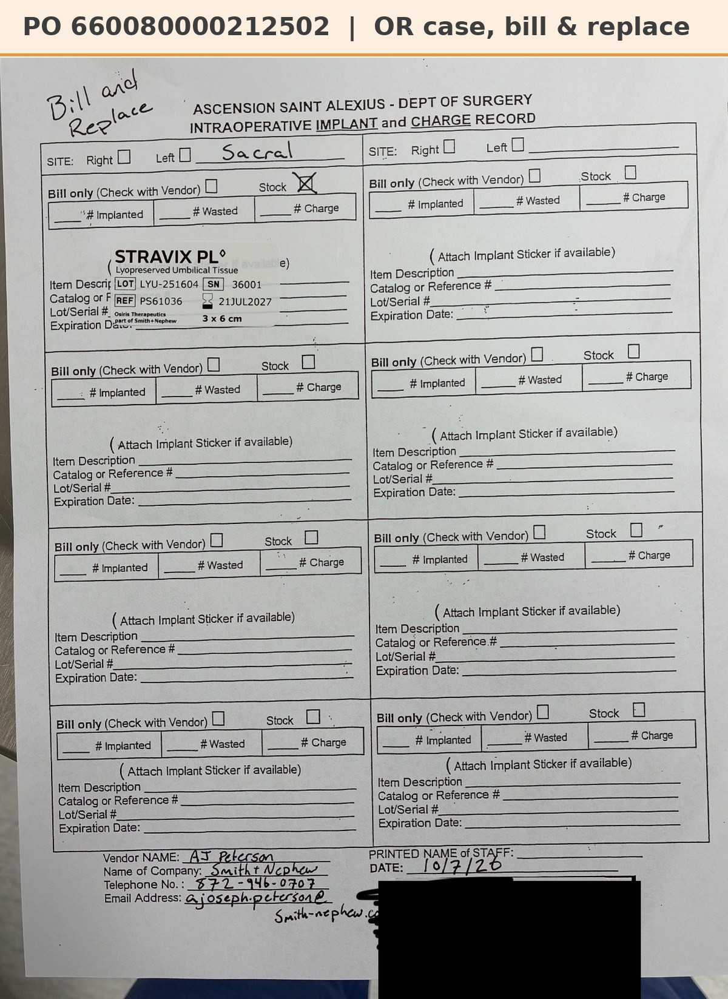

# Implant record: A.B. 10/7/26

[⬅ Back to tracker](../README.md) · [PDF](./ab-1007.pdf)

**OR case** (not a recurring graft patient) · St. Alexius bill & replace

**Lot/SN**
```
LYU-251604_36001
```
**PO**
```
660080000212502
```

| Field | Value |
| --- | --- |
| Date of service | 10/7/26 |
| Patient | A.B. |
| Account | Ascension Saint Alexius (OR) |
| Surgeon | Dr. Guske |
| Site | Sacral |
| Product | Stravix PL 3x6 cm |
| REF | PS61036 |
| Lot / SN | LYU-251604 / 36001 |
| Expiry | 7/21/27 |
| Price | $2,469.00 |
| Status | From St. Alexius stock (bill & replace). PO 660080000212502 received 10/8; ready to submit. SFDC will show the replacement serial |


