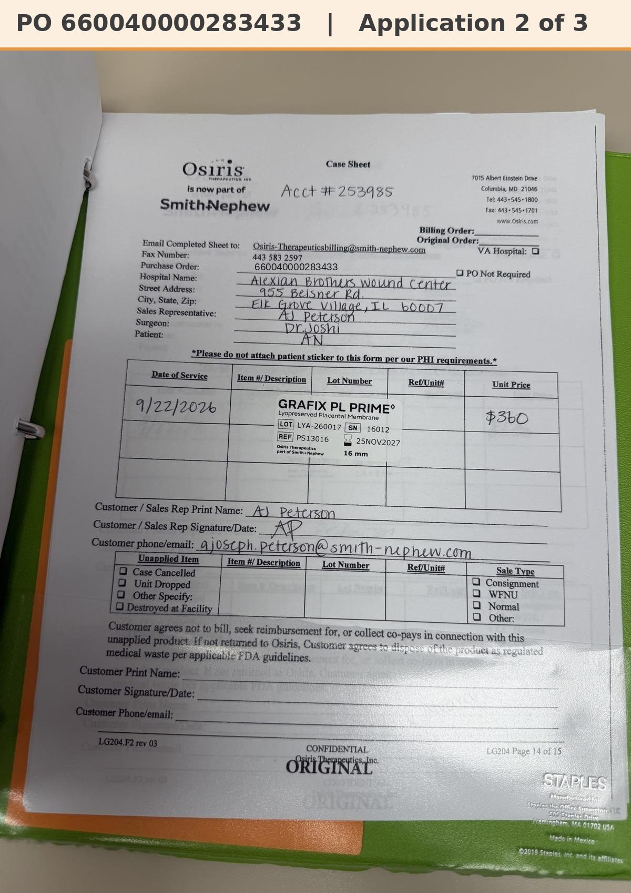

# Case sheet: A.N. 9/22/26

[⬅ Back to tracker](../README.md) · [PDF](./an-0922.pdf)

**Lot/SN**
```
LYA-260017_16012
```
**PO**
```
660040000283433
```
**Alexian ID**
```
0002817866
```

| Field | Value |
| --- | --- |
| Date of service | 9/22/26 |
| Patient | A.N. |
| Account | Alexian Brothers Wound Center |
| Surgeon | Dr. Joshi |
| Product | Grafix PL Prime 16mm disc |
| REF | PS13016 |
| Lot | LYA-260017 |
| SN | 16012 |
| Price | $360.00 |
| Expiry | 11/25/27 |
| Status | In SFDC |
| Note | In SFDC: inv 0985785270 on PO ...283433. Patient ID 0002817866 = A.N. |


