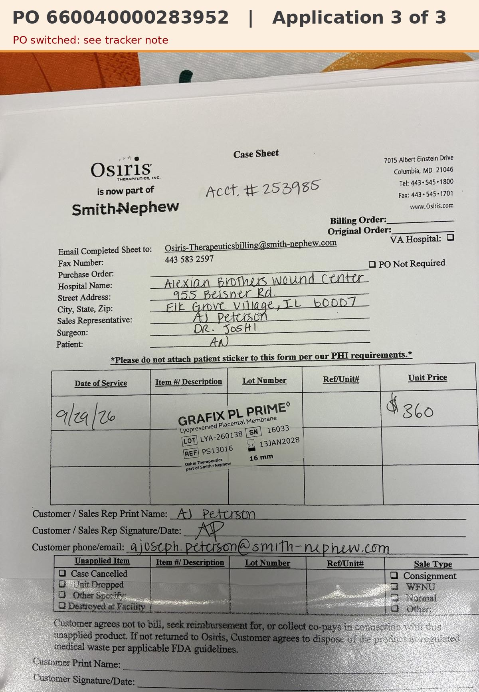

# Case sheet: A.N. 9/29/26

[⬅ Back to tracker](../README.md) · [PDF](./an-0929.pdf)

**Application #3** of 3 to date (per the 10/2 patient list)

**Lot/SN**
```
LYA-260138_16033
```
**PO**
```
660040000283952
```
**Alexian ID**
```
0002817866
```

| Field | Value |
| --- | --- |
| Date of service | 9/29/26 |
| Patient | A.N. |
| Account | Alexian Brothers Wound Center |
| Surgeon | Dr. Joshi |
| Product | Grafix PL Prime 16mm disc |
| REF | PS13016 |
| Lot | LYA-260138 |
| SN | 16033 |
| Price | $360.00 |
| Expiry | 1/13/28 |
| Application | #3 of 3 to date |
| Status | In SFDC |
| Note | App #3 of 3 (10/2 list). PO SWITCHED: billed on ...283952 (inv 0985785272), which was M.L.'s PO (Patient ID 0003052747). A.N.'s own PO ...283975 now sits on M.L. In SFDC |


