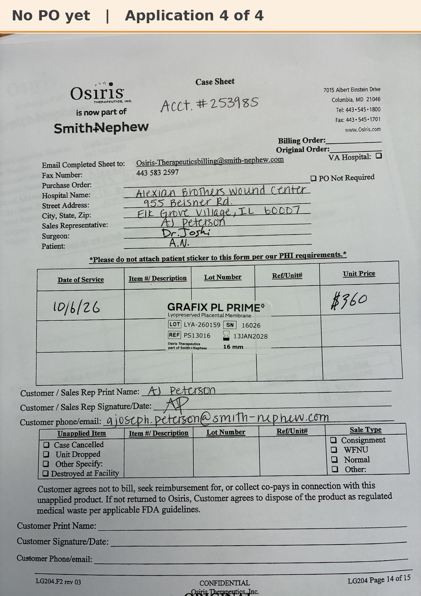

# Case sheet: A.N. 10/6/26

[⬅ Back to tracker](../README.md) · [PDF](./an-1006.pdf)

**Application #4**

**Lot/SN**
```
LYA-260159_16026
```
**PO**
```
660040000284482
```

| Field | Value |
| --- | --- |
| Date of service | 10/6/26 |
| Patient | A.N. |
| Account | Alexian Brothers Wound Center (Acct #253985) |
| Surgeon | Dr. Joshi |
| Product | Grafix PL Prime 16mm disc |
| REF | PS13016 |
| Lot | LYA-260159 |
| SN | 16026 |
| Price | $360.00 |
| Expiry | 1/13/28 |
| Application | #4 |
| Status | Ready to submit (PO 660040000284482, 10/6, sent 10/14) |


