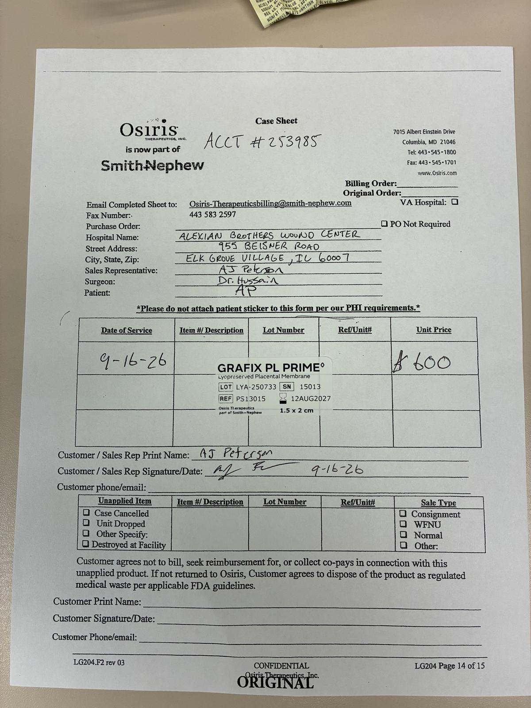

# Case sheet: A.P. 9/16/26

[⬅ Back to tracker](../README.md) · [PDF](./ap-0916.pdf)

**Application #1** of 3 to date (per the 10/2 patient list)

**Lot/SN**
```
LYA-250733_15013
```
**PO**
```
none yet
```
**Alexian ID**
```
0003068368
```

| Field | Value |
| --- | --- |
| Date of service | 9/16/26 |
| Patient | A.P. |
| Account | Alexian Brothers Wound Center |
| Surgeon | Dr. Hussain |
| Product | Grafix PL Prime 1.5 x 2 |
| REF | PS13015 |
| Lot | LYA-250733 |
| SN | 15013 |
| Price | $600.00 |
| Expiry | 8/12/27 |
| Application | #1 of 3 to date |
| Status | Not submitted |
| Note | App #1 of 3 (10/2 list). No PO yet (Patient ID per Sept tab) |


