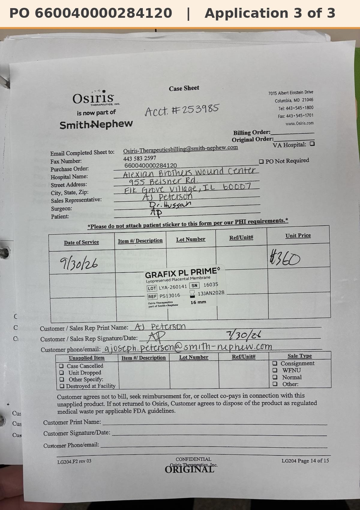

# Case sheet: A.P. 9/30/26

[⬅ Back to tracker](../README.md) · [PDF](./ap-0930.pdf)

**Application #3** of 3 to date (per the 10/2 patient list)

**Lot/SN**
```
LYA-260141_16035
```
**PO**
```
660040000284120
```
**Alexian ID**
```
0003068368
```

| Field | Value |
| --- | --- |
| Date of service | 9/30/26 |
| Patient | A.P. |
| Account | Alexian Brothers Wound Center |
| Surgeon | Dr. Hussain |
| Product | Grafix PL Prime 16mm disc |
| REF | PS13016 |
| Lot | LYA-260141 |
| SN | 16035 |
| Price | $360.00 |
| Expiry | 1/13/28 |
| Application | #3 of 3 to date |
| Status | Not submitted |
| Note | App #3 of 3 (10/2 list). PO ...284120 confirmed: Patient ID 0003068368 = A.P., DOS 9/30, PS13016 16mm $360 |


