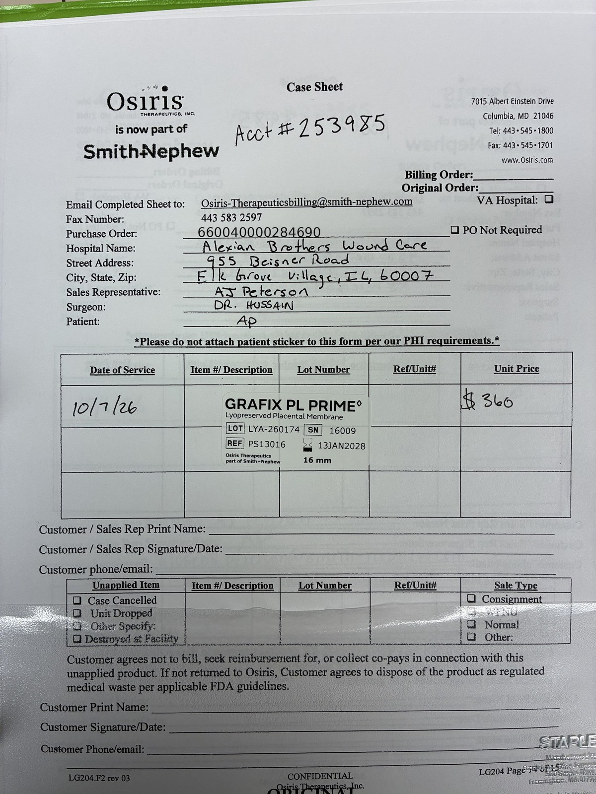

# Case sheet: A.P. 10/7/26

[⬅ Back to tracker](../README.md) · [PDF](./ap-1007.pdf)

**Application #4** (Alexian WCC stops at 8; PA required)

**Lot/SN**
```
LYA-260174_16009
```
**PO**
```
660040000284690
```
**Alexian ID**
```
0003068368
```

| Field | Value |
| --- | --- |
| Date of service | 10/7/26 |
| Patient | A.P. |
| Account | Alexian Brothers Wound Center (Acct #253985) |
| Surgeon | Dr. Hussain |
| Product | Grafix PL Prime 16mm disc |
| REF | PS13016 |
| Lot | LYA-260174 |
| SN | 16009 |
| Price | $360.00 |
| Expiry | 1/13/28 |
| Application | #4 |
| Status | Ready to submit (PO received 10/8, case sheet 10/9) |


