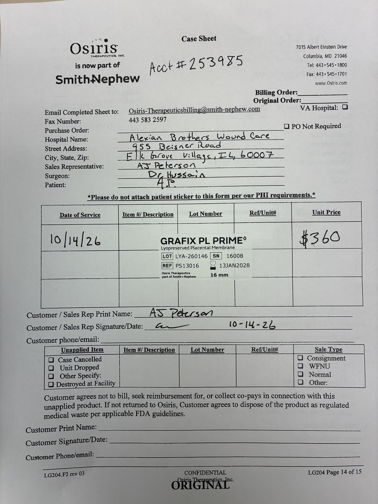

# Case sheet: A.P. 10/14/26

[⬅ Back to tracker](../README.md) · [PDF](./ap-1014.pdf)

**Application #5**

**Lot/SN**
```
LYA-260146_16008
```
**PO**
```
660040000285130
```
**Alexian ID**
```
0003068368
```

| Field | Value |
| --- | --- |
| Date of service | 10/14/26 (2:00 PM) |
| Patient | A.P. |
| Account | Alexian Brothers Wound Center (Acct #253985) |
| Surgeon | Dr. Hussain |
| Product | Grafix PL Prime 16mm disc |
| REF | PS13016 |
| Lot | LYA-260146 |
| SN | 16008 |
| Price | $360.00 |
| Expiry | 1/13/28 |
| Application | #5 (PA required) |
| Status | Ready to submit (PO 660040000285130, 10/14) |
| Note | Case sheet photo uploaded in the Patients app 10/14. From the Alexian WCC shelf |


