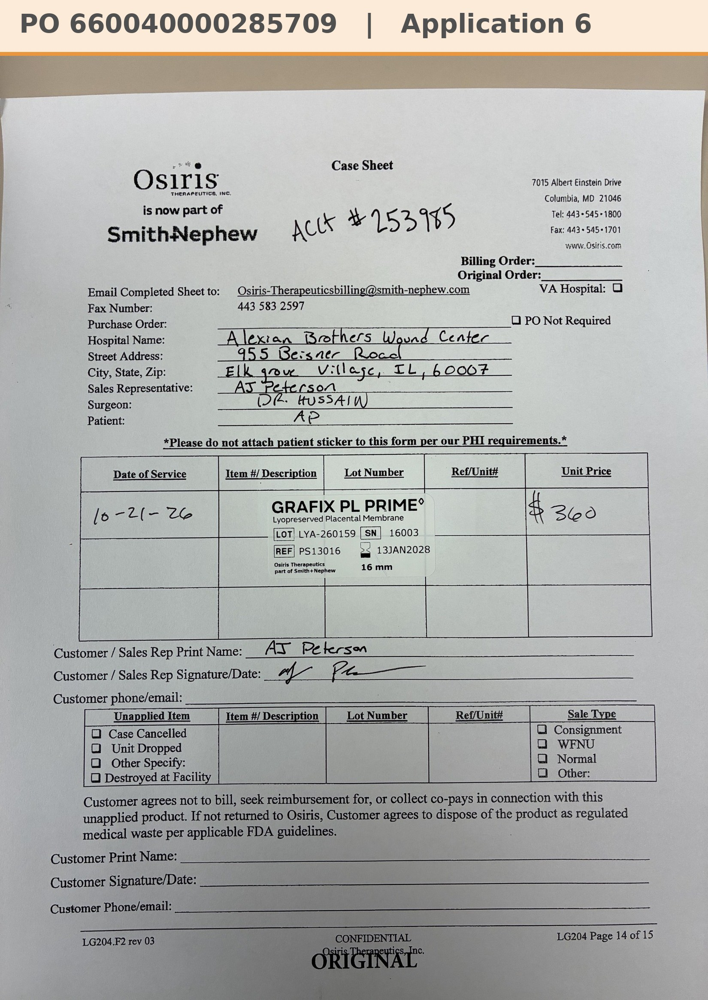

# Case sheet: A.P. 10/21/26

[⬅ Back to tracker](../README.md) · [PDF](./ap-1021.pdf)

**Application #6**

**Lot/SN**
```
LYA-260159_16003
```
**PO**
```
660040000285709
```
**Alexian ID**
```
0003068368
```

| Field | Value |
| --- | --- |
| Date of service | 10/21/26 |
| Patient | A.P. |
| Account | Alexian Brothers Wound Center (Acct #253985) |
| Surgeon | Dr. Hussain |
| Product | Grafix PL Prime 16mm disc |
| REF | PS13016 |
| Lot | LYA-260159 |
| SN | 16003 |
| Price | $360.00 |
| Expiry | 1/13/28 |
| Application | #6 |
| Status | Ready to submit (PO 660040000285709, 10/21) |
| Note | Case sheet photo sent 10/27. From the Alexian WCC shelf. PA required |


