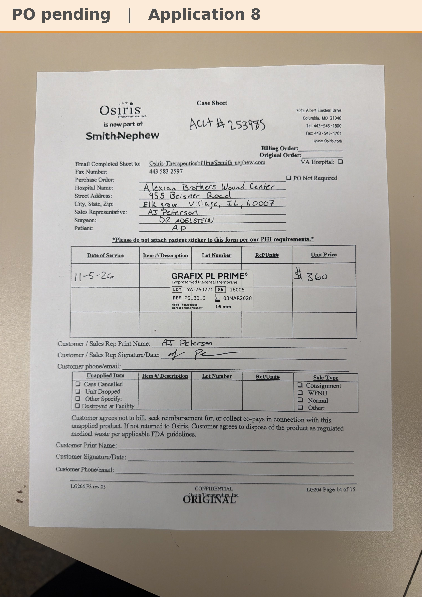

# Case sheet: A.P. 11/5/26

[⬅ Back to tracker](../README.md) · [PDF](./ap-1105.pdf)

**Application #8**

**Lot/SN**
```
LYA-260221_16005
```
**PO**
```
pending
```
**Alexian ID**
```
0003068368
```

| Field | Value |
| --- | --- |
| Date of service | 11/5/26 (10:30 AM) |
| Patient | A.P. |
| Account | Alexian Brothers Wound Center (Acct #253985) |
| Surgeon | Dr. Adelstein (on the sheet; the patient is Dr. Hussain's) |
| Product | Grafix PL Prime 16mm disc |
| REF | PS13016 |
| Lot | LYA-260221 |
| SN | 16005 |
| Price | $360.00 |
| Expiry | 3/3/28 |
| Application | #8 |
| Status | Waiting on the PO (bill only, by patient ID) |
| Note | Case sheet photo uploaded in Chi West 11/5. A8 is the last application under the Alexian WCC cap of 8; marked Done in Chi West. From the Alexian WCC shelf. The PO line and banner get updated when the PO arrives |


