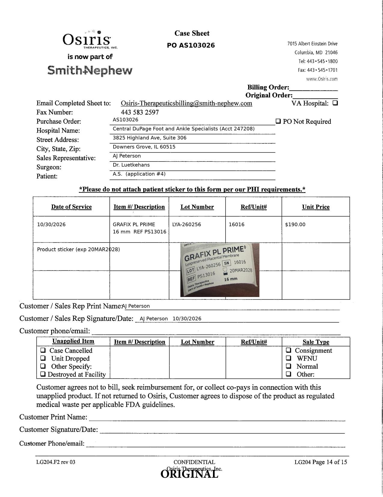

# Case sheet: A.S. 10/30/26

[⬅ Back to tracker](../README.md) · [PDF](./as-1030.pdf)

**Application #4**

**Lot/SN**
```
LYA-260256_16016
```
**PO**
```
AS103026
```

| Field | Value |
| --- | --- |
| Date of service | 10/30/26 (12:00 PM) |
| Patient | A.S. |
| Account | Central DuPage Foot and Ankle Specialists (Acct #247208), Downers Grove office |
| Surgeon | Dr. Luetkehans |
| Product | Grafix PL Prime 16mm disc |
| REF | PS13016 |
| Lot | LYA-260256 |
| SN | 16016 |
| Price | $190.00 |
| Expiry | 3/20/28 |
| Application | #4 |
| Status | In SFDC (sale order AS103026, submitted 10/27, in SFDC 10/28) |
| Note | Case sheet made 10/31 from the sticker photo logged in the Patients app 10/30 (the unit shipped on PO AS103026 for this visit). Kept in the Graft Tracker app until the repo was reachable; added here 11/1 |


