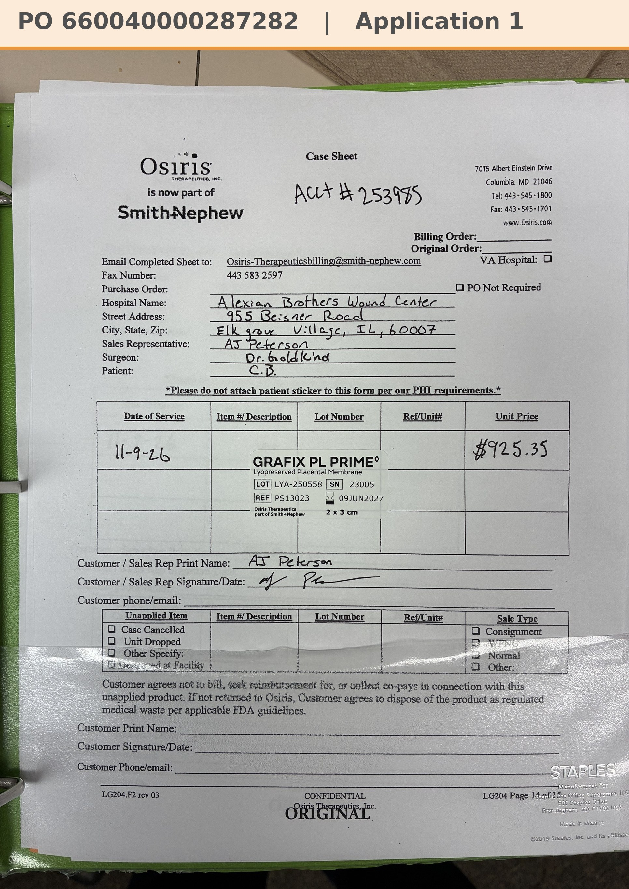

# Case sheet: C.B. 11/9/26

[⬅ Back to tracker](../README.md) · [PDF](./cb-1109.pdf)

**Application #1**

**Lot/SN**
```
LYA-250558_23005
```
**PO**
```
660040000287282
```
**Alexian ID**
```
0003103740
```

| Field | Value |
| --- | --- |
| Date of service | 11/9/26 (2:15 PM) |
| Patient | C.B. |
| Account | Alexian Brothers Wound Center (Acct #253985) |
| Surgeon | Dr. Goldkind |
| Product | Grafix PL Prime 2 x 3 |
| REF | PS13023 |
| Lot | LYA-250558 |
| SN | 23005 |
| Price | $925.35 |
| Expiry | 6/9/27 |
| Application | #1 |
| Status | Ready to submit (PO 660040000287282, dated 11/10, received 11/10) |
| Note | AJ's case sheet photo from Chi West 11/9, with the Grafted tap. New patient (added in Chi West 11/5), first application. From the Alexian WCC shelf. PO 660040000287282 (bill only, matched by patient ID) came in 11/10 and is in the banner. |


