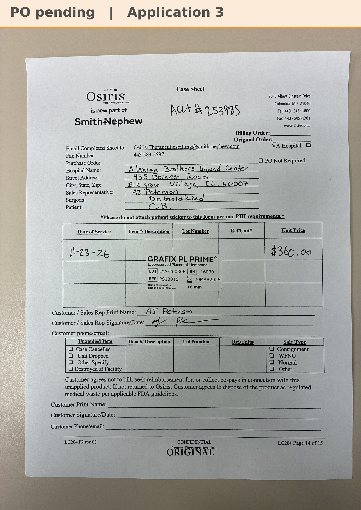

# Case sheet: C.B. 11/23/26

[⬅ Back to tracker](../README.md) · [PDF](./cb-1123.pdf)

**Application #3**

**Lot/SN**
```
LYA-260306_16030
```
**Alexian ID**
```
0003103740
```

| Field | Value |
| --- | --- |
| Date of service | 11/23/26 (2:00 PM) |
| Patient | C.B. |
| Account | Alexian Brothers Wound Center (Acct #253985) |
| Surgeon | Dr. Goldkind |
| Product | Grafix PL Prime 16mm disc |
| REF | PS13016 |
| Lot | LYA-260306 |
| SN | 16030 |
| Price | $360 |
| Expiry | 3/20/28 |
| Application | #3 |
| Status | Waiting on the bill-only PO |
| Note | AJ's case sheet photo from Chi West 11/23 (with the Grafted tap). From the Alexian WCC shelf. |


