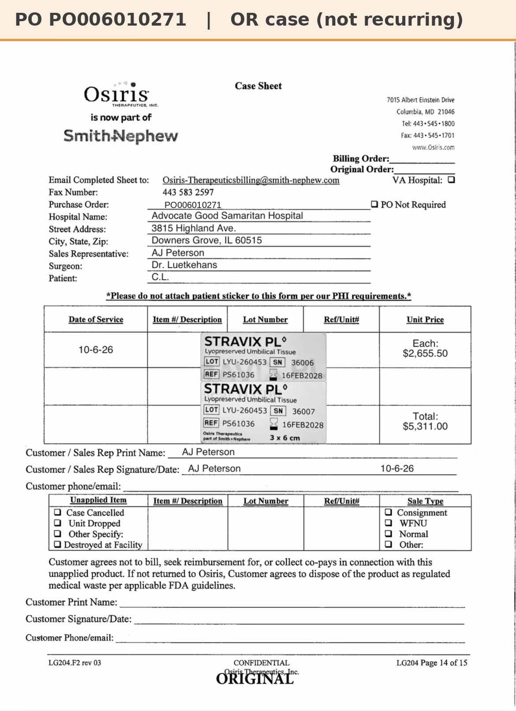

# Case sheet: C.L. 10/6/26

[⬅ Back to tracker](../README.md) · [PDF](./cl-1006.pdf)

**OR case** (not a recurring graft patient)

**Lot/SN**
```
LYU-260453_36006
```
```
LYU-260453_36007
```
**PO**
```
PO006010271
```

| Field | Value |
| --- | --- |
| Date of service | 10/6/26 |
| Patient | C.L. |
| Account | Advocate Good Samaritan Hospital (OR) |
| Surgeon | Dr. Luetkehans |
| Product | Stravix PL 3x6 cm × 2 |
| REF | PS61036 |
| Units | LYU-260453_36006, LYU-260453_36007 (exp 2/16/28) |
| Price | $2,655.50 each, $5,311.00 total |
| Status | Ready to submit (PO PO006010271 received 10/7) |


