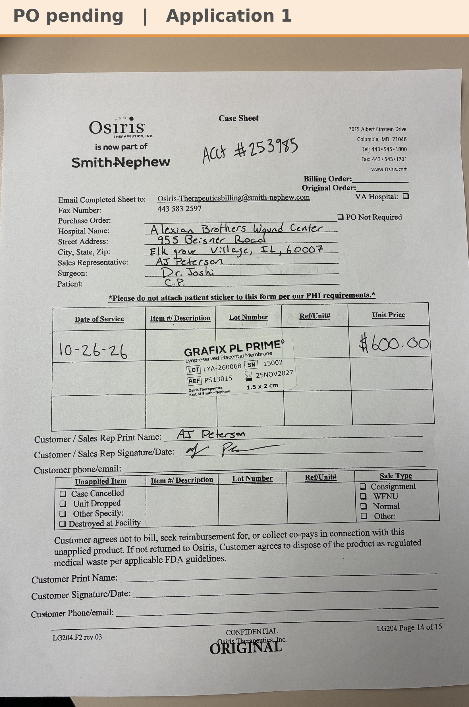

# Case sheet: C.P. 10/26/26

[⬅ Back to tracker](../README.md) · [PDF](./cp-1026.pdf)

**Application #1** (first application)

**Lot/SN**
```
LYA-260068_15002
```
**PO**
```
pending
```
**Alexian ID**
```
0002759724
```

| Field | Value |
| --- | --- |
| Date of service | 10/26/26 |
| Patient | C.P. |
| Account | Alexian Brothers Wound Center (Acct #253985) |
| Surgeon | Dr. Joshi |
| Product | Grafix PL Prime 1.5 x 2 |
| REF | PS13015 |
| Lot | LYA-260068 |
| SN | 15002 |
| Price | $600.00 |
| Expiry | 11/25/27 |
| Application | #1 |
| Status | Waiting on the Alexian PO |
| Note | Case sheet photo sent 10/27 (first application; the WCC application log shows the same sticker as graft #1). From the Alexian WCC shelf |


