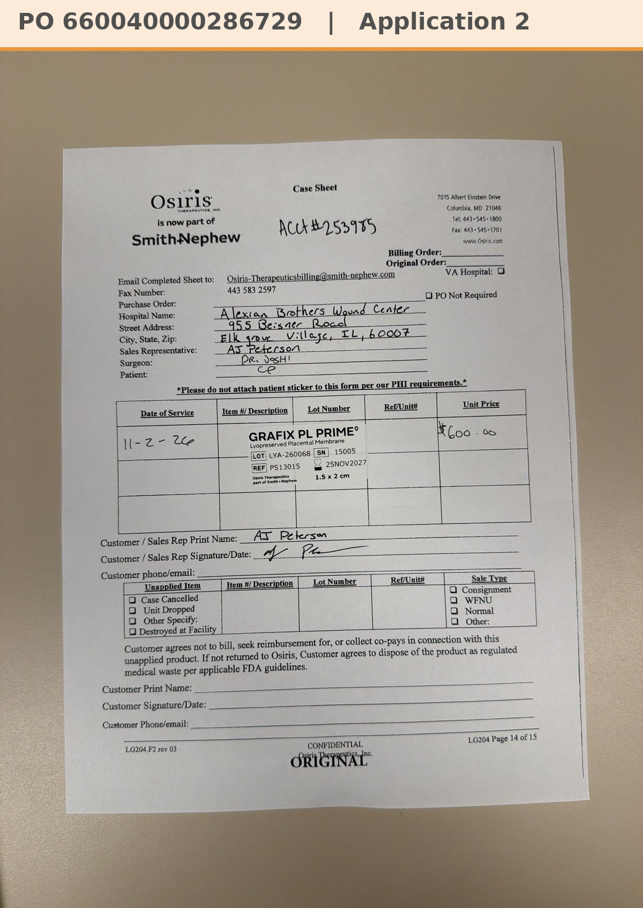

# Case sheet: C.P. 11/2/26

[⬅ Back to tracker](../README.md) · [PDF](./cp-1102.pdf)

**Application #2**

**Lot/SN**
```
LYA-260068_15005
```
**PO**
```
660040000286729
```
**Alexian ID**
```
0002759724
```

| Field | Value |
| --- | --- |
| Date of service | 11/2/26 (1:15 PM) |
| Patient | C.P. |
| Account | Alexian Brothers Wound Center (Acct #253985) |
| Surgeon | Dr. Joshi |
| Product | Grafix PL Prime 1.5 x 2 |
| REF | PS13015 |
| Lot | LYA-260068 |
| SN | 15005 |
| Price | $600.00 |
| Expiry | 11/25/27 |
| Application | #2 |
| Status | Ready to submit (PO 660040000286729, bill only, dated 11/3, received 11/5) |
| Note | Case sheet photo uploaded in the Graft Tracker app 11/2 (A1 was 10/26, [case sheet](./cp-1026.md)). From the Alexian WCC shelf. PO 660040000286729 (bill only, by patient ID) came in 11/5 and is in the banner |


