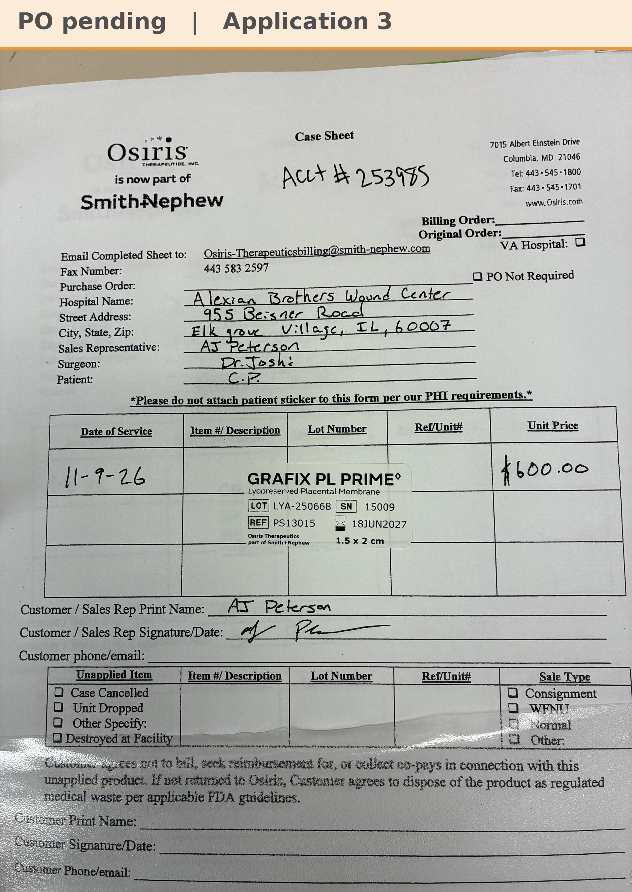

# Case sheet: C.P. 11/9/26

[⬅ Back to tracker](../README.md) · [PDF](./cp-1109.pdf)

**Application #3**

**Lot/SN**
```
LYA-250668_15009
```
**PO**
```
pending
```
**Alexian ID**
```
0002759724
```

| Field | Value |
| --- | --- |
| Date of service | 11/9/26 (1:15 PM) |
| Patient | C.P. |
| Account | Alexian Brothers Wound Center (Acct #253985) |
| Surgeon | Dr. Joshi |
| Product | Grafix PL Prime 1.5 x 2 |
| REF | PS13015 |
| Lot | LYA-250668 |
| SN | 15009 |
| Price | $600.00 |
| Expiry | 6/18/27 |
| Application | #3 |
| Status | Waiting on the PO (bill only, by patient ID) |
| Note | AJ's case sheet photo from Chi West 11/9, with the Grafted tap (A2 was 11/2, [case sheet](./cp-1102.md)). From the Alexian WCC shelf. The PO goes in the banner when it arrives |


