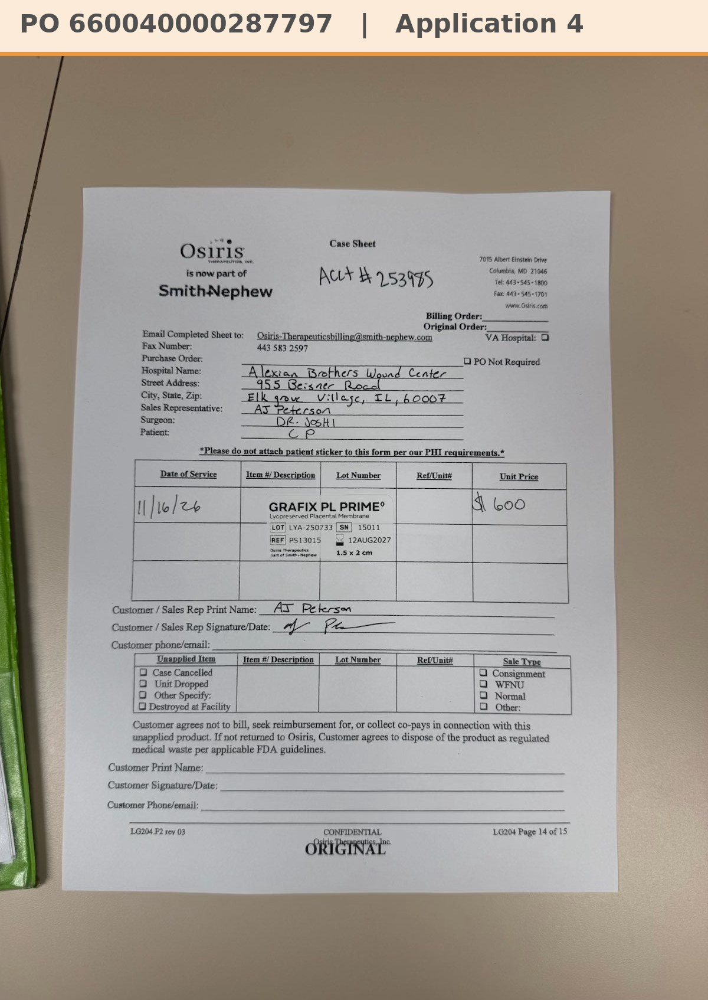

# Case sheet: C.P. 11/16/26

[⬅ Back to tracker](../README.md) · [PDF](./cp-1116.pdf)

**Application #4**

**Lot/SN**
```
LYA-250733_15011
```
**PO**
```
660040000287797
```

| Field | Value |
| --- | --- |
| Date of service | 11/16/26 |
| Patient | C.P. |
| Account | Alexian Brothers Wound Center (Acct #253985) |
| Surgeon | Dr. Joshi |
| Product | Grafix PL Prime 1.5 x 2 |
| REF | PS13015 |
| Lot | LYA-250733 |
| SN | 15011 |
| Price | $600.00 |
| Expiry | 8/12/27 |
| Application | #4 |
| Status | Ready to submit (PO 660040000287797, dated 11/17, received 11/17) |
| Note | AJ's case sheet photo, sent 11/24 (Caroline covered the visit; A3 was 11/9, [case sheet](./cp-1109.md)). From the Alexian WCC shelf. The PO (bill only, matched by date of service) came in 11/17, before the case sheet, and is in the banner. |


