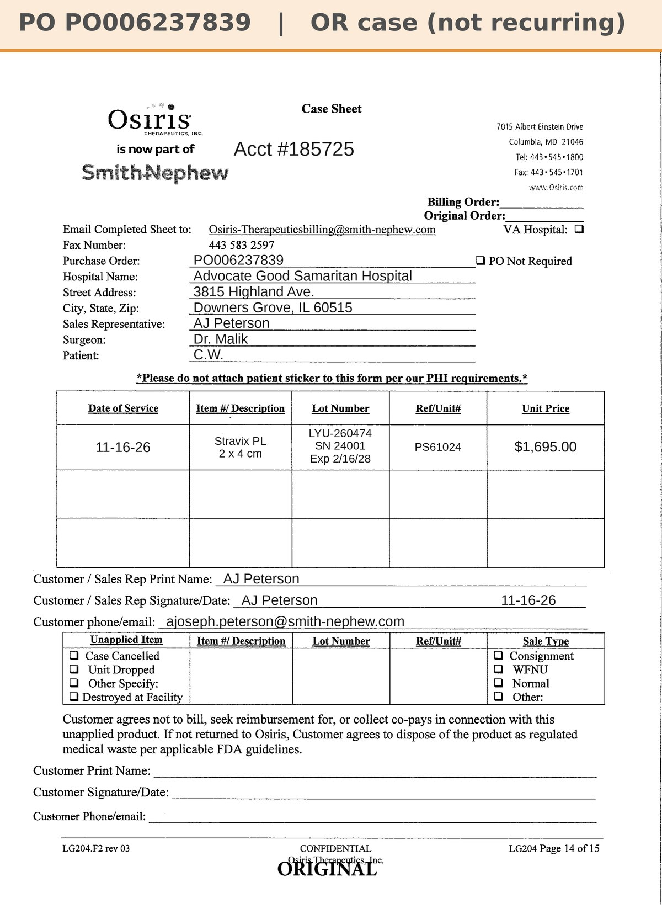

# Case sheet: C.W. 11/16/26

[⬅ Back to tracker](../README.md) · [PDF](./cw-1116.pdf)

**OR case** (not a recurring graft patient) · Good Sam OR shelf · Bill Only

**Lot/SN**
```
LYU-260474_24001
```
**PO**
```
PO006237839
```

| Field | Value |
| --- | --- |
| Date of service | 11/16/26 |
| Patient | C.W. |
| Account | Advocate Good Samaritan Hospital (OR) |
| Surgeon | Dr. Malik |
| Product | Stravix PL 2 x 4 cm |
| REF | PS61024 |
| Lot | LYU-260474 |
| SN | 24001 |
| Price | $1,695.00 |
| Expiry | 2/16/28 |
| Status | PO006237839 approved Tue 11/17 (Owens & Minor requisition, OR, DOS 11/16): Stravix PL 2x4 LYU-260474_24001, $1,695.00, matches the sticker. Ready to submit |
| Note | Typed case sheet (AJ 11/24: "create case sheet by typing in numbers") from AJ's photo of the product sticker: lot, SN, REF and expiry as printed on it. The requisition lists Dr. Luetkehans because Dr. Malik wasn't in the physician drop-down (same practice) |


