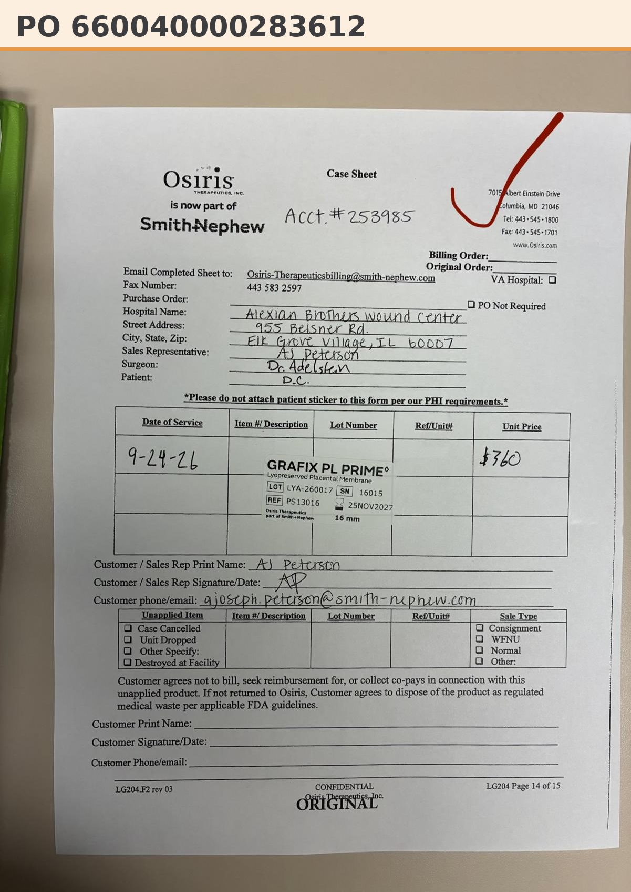

# Case sheet: D.C. 9/24/26

[⬅ Back to tracker](../README.md) · [PDF](./dc-0924.pdf)

**Lot/SN**
```
LYA-260017_16015
```
**PO**
```
660040000283612
```
**Alexian ID**
```
0002601176
```

| Field | Value |
| --- | --- |
| Date of service | 9/24/26 |
| Patient | D.C. |
| Account | Alexian Brothers Wound Center |
| Surgeon | Dr. Adelstein |
| Product | Grafix PL Prime 16mm disc |
| REF | PS13016 |
| Lot | LYA-260017 |
| SN | 16015 |
| Price | $360.00 |
| Expiry | 11/25/27 |
| Status | In SFDC |
| Note | Case sheet submitted. PO confirmed: Patient ID 0002601176 |


