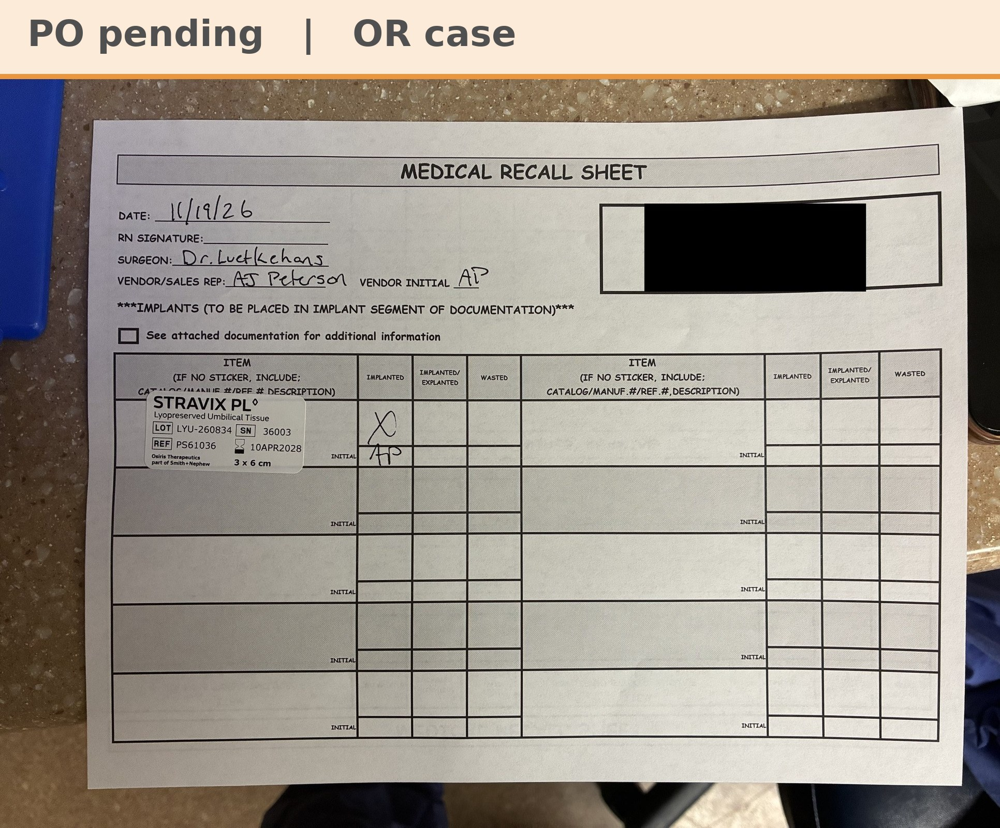

# Implant record: D.F. 11/19/26

[⬅ Back to tracker](../README.md) · [PDF](./df-1119.pdf)

**OR case** · Good Sam OR shelf · Bill Only

**Lot/SN**
```
LYU-260834_36003
```
**PO**
```
pending
```

| Field | Value |
| --- | --- |
| Date of service | 11/19/26 |
| Patient | D.F. |
| Account | Advocate Good Samaritan Hospital (OR) |
| Surgeon | Dr. Luetkehans |
| Product | Stravix PL 3 x 6 cm |
| REF | PS61036 |
| Lot | LYU-260834 |
| SN | 36003 |
| Price | $2,655.50 |
| Expiry | 4/10/28 |
| Status | Waiting on the Owens & Minor PO |
| Note | Good Sam Medical Recall Sheet (implant marked Implanted), photo from AJ 11/20. Patient label covered on this copy |


