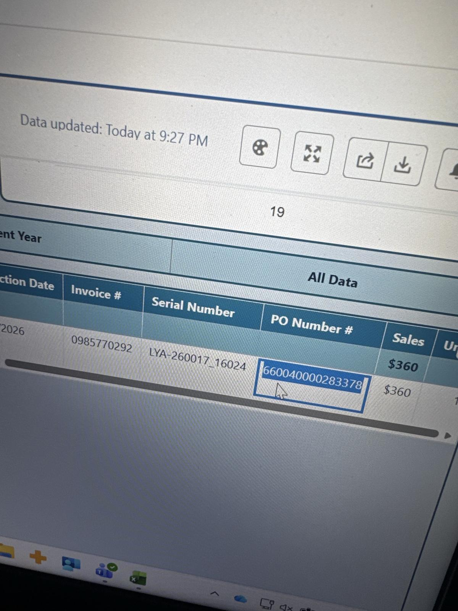

# D.G. 9/22/26 billing record (dashboard)

[⬅ Back to tracker](../README.md) · [PDF](./dg-0922-dashboard.pdf)

**Lot/SN**
```
LYA-260017_16024
```
**PO**
```
660040000283377
```
**Alexian ID**
```
0002861662
```

| Field | Value |
| --- | --- |
| Date of service | 9/22/26 |
| Patient | D.G. |
| Account | Alexian Brothers Wound Center |
| Surgeon | Dr. Lucas |
| Product | Grafix PL Prime 16mm disc |
| REF | PS13016 |
| Lot | LYA-260017 |
| SN | 16024 |
| Price | $360.00 |
| Expiry | 11/25/27 |
| Status | In SFDC |
| Note | Case sheet submitted. PO ...283377 confirmed: Patient ID 0002861662, PS13016 16mm $360, DOS 9/22. Billing corrected 9/30 (had been invoiced on T.T.'s PO ...283378) |


