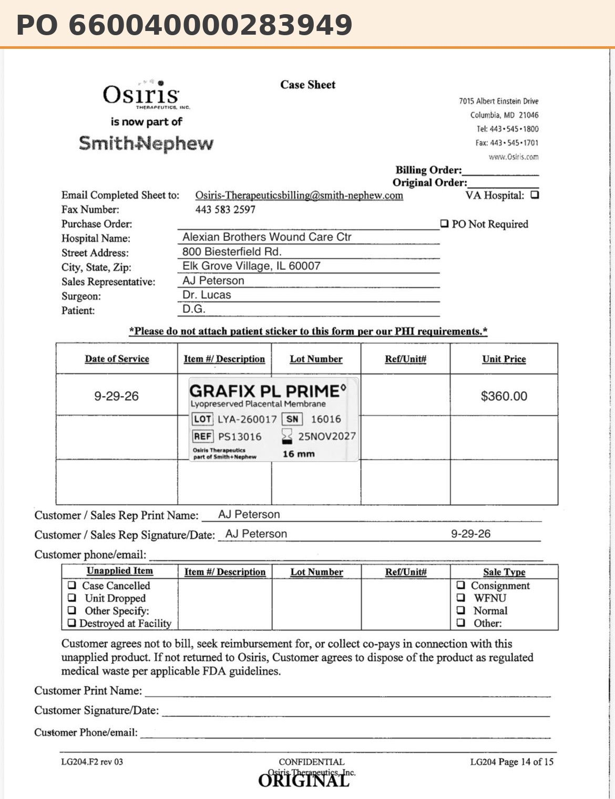

# Case sheet: D.G. 9/29/26

[⬅ Back to tracker](../README.md) · [PDF](./dg-0929.pdf)

**Lot/SN**
```
LYA-260017_16016
```
**PO**
```
660040000283949
```
**Alexian ID**
```
0002861662
```

| Field | Value |
| --- | --- |
| Date of service | 9/29/26 |
| Patient | D.G. |
| Account | Alexian Brothers Wound Center |
| Surgeon | Dr. Lucas |
| Product | Grafix PL Prime 16mm disc |
| REF | PS13016 |
| Lot | LYA-260017 |
| SN | 16016 |
| Price | $360.00 |
| Expiry | 11/25/27 |
| Status | Not submitted |
| Note | Case sheet on file. PO confirmed: Patient ID 0002861662 = D.G. |


