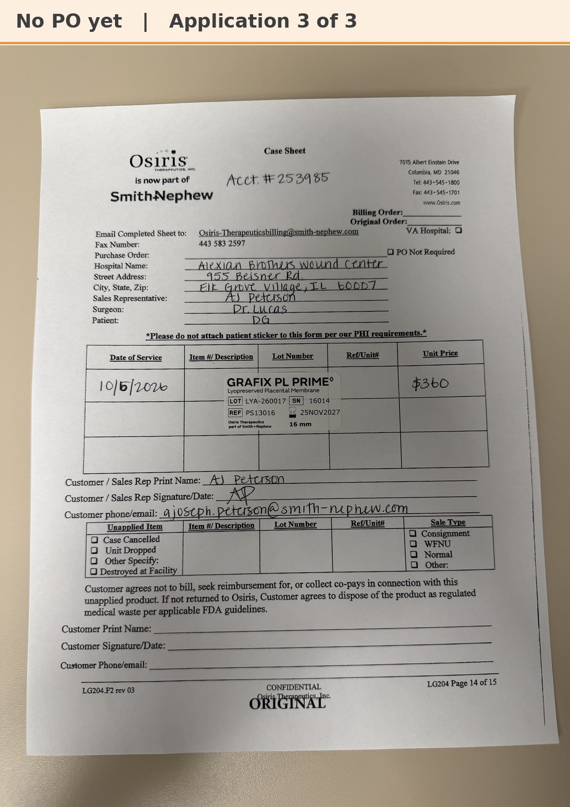

# Case sheet: D.G. 10/6/26

[⬅ Back to tracker](../README.md) · [PDF](./dg-1006.pdf)

**Application #3**

**Lot/SN**
```
LYA-260017_16014
```
**PO**
```
none yet
```

| Field | Value |
| --- | --- |
| Date of service | 10/6/26 |
| Patient | D.G. |
| Account | Alexian Brothers Wound Center (Acct #253985) |
| Surgeon | Dr. Lucas |
| Product | Grafix PL Prime 16mm disc |
| REF | PS13016 |
| Lot | LYA-260017 |
| SN | 16014 |
| Price | $360.00 |
| Expiry | 11/25/27 |
| Application | #3 |
| Status | Waiting on the Alexian PO |


