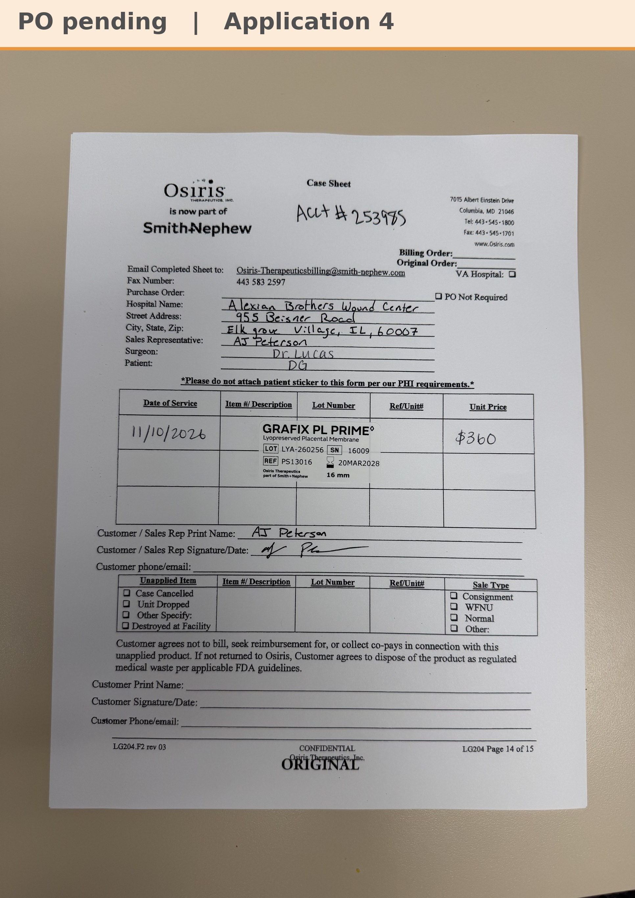

# Case sheet: D.G. 11/10/26

[⬅ Back to tracker](../README.md) · [PDF](./dg-1110.pdf)

**Application #4**

**Lot/SN**
```
LYA-260256_16009
```
**PO**
```
pending
```
**Alexian ID**
```
0002861662
```

| Field | Value |
| --- | --- |
| Date of service | 11/10/26 (9:00 AM) |
| Patient | D.G. |
| Account | Alexian Brothers Wound Center (Acct #253985) |
| Surgeon | Dr. Lucas |
| Product | Grafix PL Prime 16mm disc |
| REF | PS13016 |
| Lot | LYA-260256 |
| SN | 16009 |
| Price | $360 |
| Expiry | 3/20/28 |
| Application | #4 |
| Status | Waiting on the bill-only PO |
| Note | AJ's case sheet photo from Chi West 11/10, with the Grafted tap. From the Alexian WCC shelf. AJ: most likely last graft, almost healed. |


