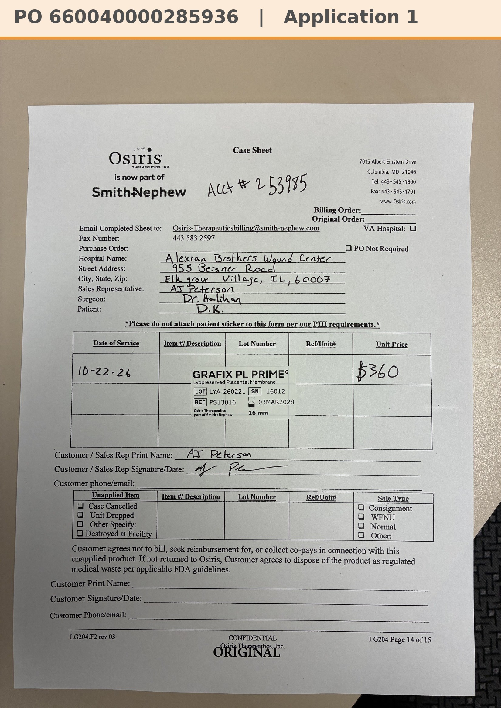

# Case sheet: D.K. 10/22/26

[⬅ Back to tracker](../README.md) · [PDF](./dk-1022.pdf)

**Application #1** (first application)

**Lot/SN**
```
LYA-260221_16012
```
**PO**
```
660040000285936
```
**Alexian ID**
```
0003096605
```

| Field | Value |
| --- | --- |
| Date of service | 10/22/26 (1:15 PM) |
| Patient | D.K. |
| Account | Alexian Brothers Wound Center (Acct #253985) |
| Surgeon | Dr. Halihan |
| Product | Grafix PL Prime 16mm disc |
| REF | PS13016 |
| Lot | LYA-260221 |
| SN | 16012 |
| Price | $360.00 |
| Expiry | 3/3/28 |
| Application | #1 |
| Status | Ready to submit (PO 660040000285936, 10/23) |
| Note | Case sheet photo from the Patients app (10/22). From the Alexian WCC shelf (10/14 delivery) |


