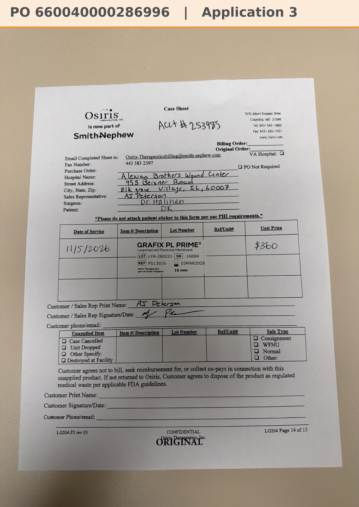

# Case sheet: D.K. 11/5/26

[⬅ Back to tracker](../README.md) · [PDF](./dk-1105.pdf)

**Application #3**

**Lot/SN**
```
LYA-260221_16004
```
**PO**
```
660040000286996
```
**Alexian ID**
```
0003096605
```

| Field | Value |
| --- | --- |
| Date of service | 11/5/26 (1:15 PM) |
| Patient | D.K. |
| Account | Alexian Brothers Wound Center (Acct #253985) |
| Surgeon | Dr. Halihan |
| Product | Grafix PL Prime 16mm disc |
| REF | PS13016 |
| Lot | LYA-260221 |
| SN | 16004 |
| Price | $360 |
| Expiry | 3/3/28 |
| Application | #3 |
| Status | Ready to submit (PO 660040000286996, bill only, dated 11/5, received 11/6) |
| Note | Case sheet photo uploaded in Chi West 11/5 (A1 10/22, A2 10/29). From the Alexian WCC shelf. PO 660040000286996 (bill only, by patient ID) came in 11/6 and is in the banner |


