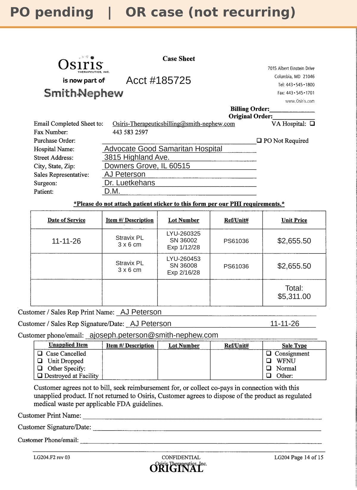

# Case sheet: D.M. 11/11/26

[⬅ Back to tracker](../README.md) · [PDF](./dm-1111.pdf)

**OR case** (not a recurring graft patient)

**Lot/SN**
```
LYU-260325_36002
```
```
LYU-260453_36008
```
**PO**
```
pending
```

| Field | Value |
| --- | --- |
| Date of service | 11/11/26 |
| Patient | D.M. |
| Account | Advocate Good Samaritan Hospital (OR) |
| Surgeon | Dr. Luetkehans |
| Product | Stravix PL 3x6 cm × 2 |
| REF | PS61036 |
| Units | LYU-260325_36002 (exp 1/12/28), LYU-260453_36008 (exp 2/16/28) |
| Price | $2,655.50 each, $5,311.00 total |
| Status | Waiting on PO |
| Note | Typed case sheet (AJ 11/12), from the hospital's implant record; left foot |


