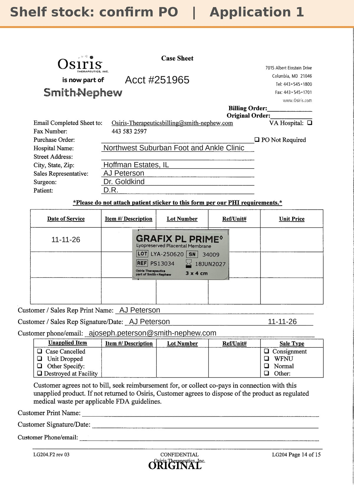

# Case sheet: D.R. 11/11/26

[⬅ Back to tracker](../README.md) · [PDF](./dr-1111.pdf)

**Application #1**

**Lot/SN**
```
LYA-250620_34009
```
**PO**
```
pending (AJ: from shelf stock; confirm whether a sale order is needed)
```

| Field | Value |
| --- | --- |
| Date of service | 11/11/26 |
| Patient | D.R. |
| Account | Northwest Suburban Foot and Ankle Clinic (Hoffman Estates) |
| Surgeon | Dr. Goldkind |
| Product | Grafix PL Prime 3x4 |
| REF | PS13034 |
| Lot | LYA-250620 |
| SN | 34009 |
| Price | not set (shelf stock) |
| Expiry | 6/18/27 |
| Application | #1 (first graft, 5:00 PM) |
| Status | Shelf stock per AJ's note; confirm PO / sale order |
| Note | Made from the sticker on AJ's application-sheet photo uploaded in Chi West 11/11 (the tap said 16mm; the sticker is 3x4). AJ: wants a 3x3 ordered for next week |


