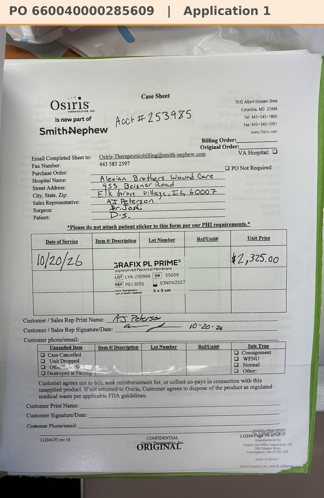

# Case sheet: D.S. 10/20/26

[⬅ Back to tracker](../README.md) · [PDF](./ds-1020.pdf)

**Application #1** (first application)

**Lot/SN**
```
LYA-250866_55009
```
**PO**
```
660040000285609
```

| Field | Value |
| --- | --- |
| Date of service | 10/20/26 (9:15 AM) |
| Patient | D.S. |
| Account | Alexian Brothers Wound Center (Acct #253985) |
| Surgeon | Dr. Joshi |
| Product | Grafix PL Prime 5 x 5 |
| REF | PS13055 |
| Lot | LYA-250866 |
| SN | 55009 |
| Price | $2,325.00 |
| Expiry | 11/3/27 |
| Application | #1 |
| Status | Ready to submit (PO 660040000285609, 10/20) |
| Note | Case sheet photo from the Patients app (10/20). From the Alexian WCC shelf. Not in the SFDC export through 10/23 |


