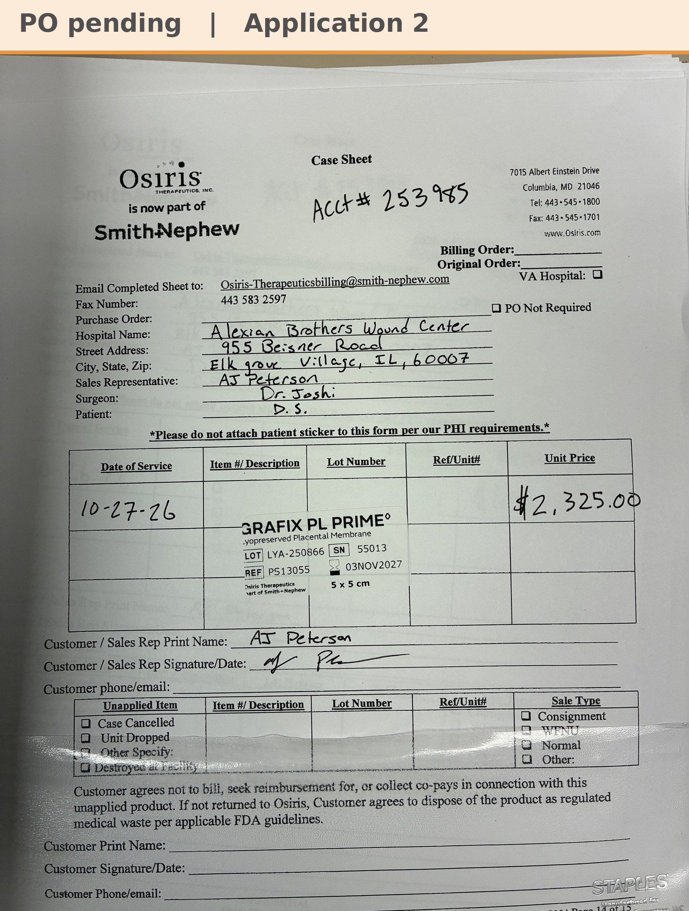

# Case sheet: D.S. 10/27/26

[⬅ Back to tracker](../README.md) · [PDF](./ds-1027.pdf)

**Application #2**

**Lot/SN**
```
LYA-250866_55013
```
**PO**
```
pending
```

| Field | Value |
| --- | --- |
| Date of service | 10/27/26 (9:15 AM) |
| Patient | D.S. |
| Account | Alexian Brothers Wound Center (Acct #253985) |
| Surgeon | Dr. Joshi |
| Product | Grafix PL Prime 5 x 5 |
| REF | PS13055 |
| Lot | LYA-250866 |
| SN | 55013 |
| Price | $2,325.00 |
| Expiry | 11/3/27 |
| Application | #2 |
| Status | Waiting on the Alexian PO |
| Note | Case sheet photo sent 10/27. From the Alexian WCC shelf |


