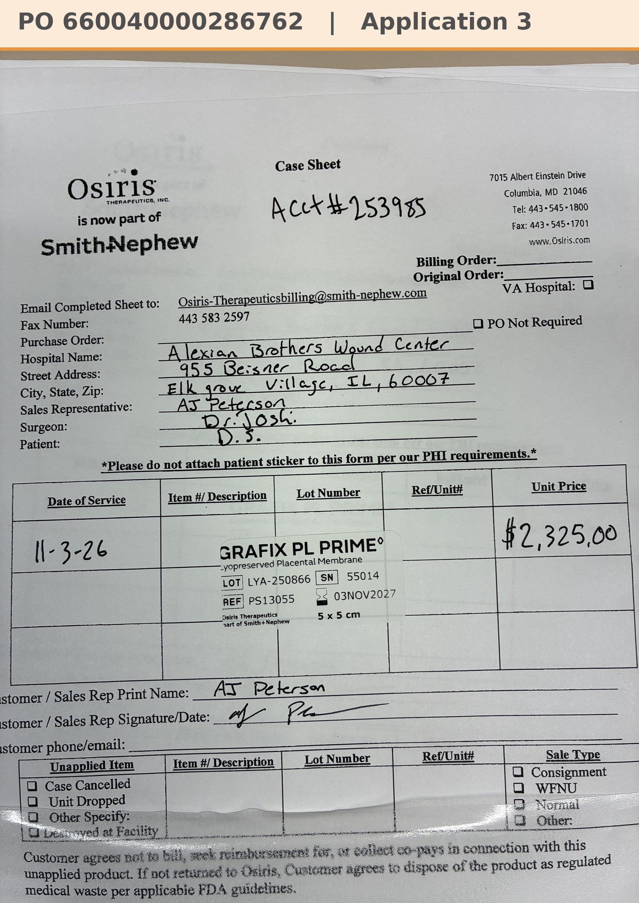

# Case sheet: D.S. 11/3/26

[⬅ Back to tracker](../README.md) · [PDF](./ds-1103.pdf)

**Application #3**

**Lot/SN**
```
LYA-250866_55014
```
**PO**
```
660040000286762
```
**Alexian ID**
```
0003081837
```

| Field | Value |
| --- | --- |
| Date of service | 11/3/26 (9:15 AM) |
| Patient | D.S. |
| Account | Alexian Brothers Wound Center (Acct #253985) |
| Surgeon | Dr. Joshi |
| Product | Grafix PL Prime 5 x 5 |
| REF | PS13055 |
| Lot | LYA-250866 |
| SN | 55014 |
| Price | $2,325.00 |
| Expiry | 11/3/27 |
| Application | #3 |
| Status | Ready to submit (PO 660040000286762, bill only, dated 11/3, received 11/5) |
| Note | Case sheet photo sent 11/3 (also uploaded in the Patients app). From the Alexian WCC shelf. Most likely moving to 3x4 next week. PO 660040000286762 (bill only, by patient ID) came in 11/5 and is in the banner |


