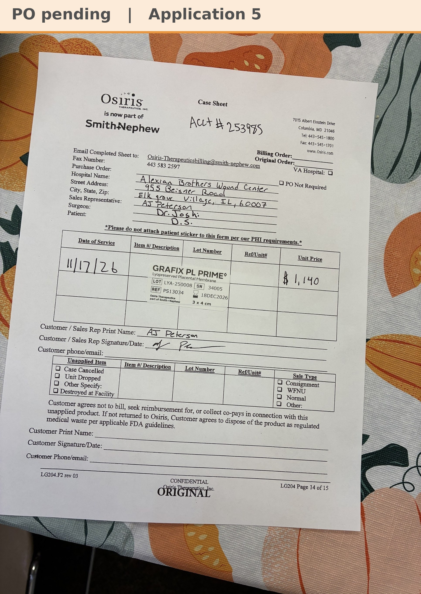

# Case sheet: D.S. 11/17/26

[⬅ Back to tracker](../README.md) · [PDF](./ds-1117.pdf)

**Application #5**

**Lot/SN**
```
LYA-250008_34005
```
**PO**
```
pending
```
**Alexian ID**
```
0003081837
```

| Field | Value |
| --- | --- |
| Date of service | 11/17/26 (9:15 AM) |
| Patient | D.S. |
| Account | Alexian Brothers Wound Center (Acct #253985) |
| Surgeon | Dr. Joshi |
| Product | Grafix PL Prime 3 x 4 |
| REF | PS13034 |
| Lot | LYA-250008 |
| SN | 34005 |
| Price | $1,140 |
| Expiry | 12/18/26 |
| Application | #5 |
| Status | Waiting on the bill-only PO |
| Note | AJ's case sheet photo from Chi West 11/17 (with the Grafted tap). From the Alexian WCC shelf. |


