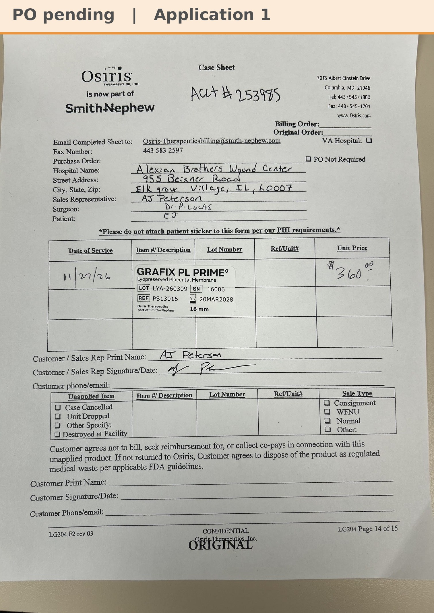

# Case sheet: E.J. 11/27/26

[⬅ Back to tracker](../README.md) · [PDF](./ej-1127.pdf)

**Application 1** · New start at Alexian WCC · Bill Only

**Lot/SN**
```
LYA-260309_16006
```
**PO**
```
pending
```

| Field | Value |
| --- | --- |
| Date of service | 11/27/26 |
| Patient | E.J. |
| Account | Alexian Brothers Wound Center (Acct #253985) |
| Surgeon | Dr. Lucas |
| Product | Grafix PL Prime 16mm (PS13016) |
| Lot/SN | LYA-260309_16006 (exp 3/20/28) |
| Price | $360.00 |
| Status | Waiting on the bill-only PO (Alexian patient ID to come) |
| Note | Case sheet photo from AJ 11/27 (Ron Sangha covered). New start; next visit Fri 12/4 1:40 PM |


