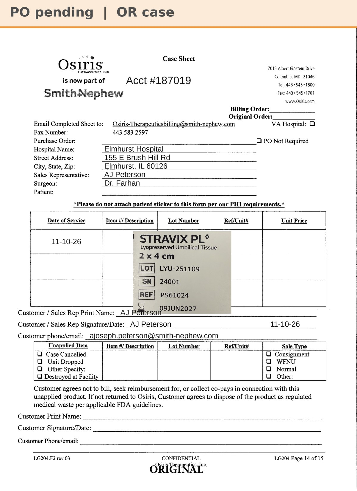

# Case sheet: Dr. Farhan 11/10/26

[⬅ Back to tracker](../README.md) · [PDF](./farhan-1110.pdf)

**OR case** (not a recurring graft patient) · Bill Only

**Lot/SN**
```
LYU-251109_24001
```
**PO**
```
pending
```

| Field | Value |
| --- | --- |
| Date of service | 11/10/26 (morning) |
| Patient | initials to come |
| Account | Elmhurst Hospital (Acct #187019) |
| Surgeon | Dr. Farhan |
| Product | Stravix PL 2 x 4 |
| REF | PS61024 |
| Lot | LYU-251109 |
| SN | 24001 |
| Price | to confirm (no Stravix 2x4 billed at Elmhurst yet) |
| Expiry | 6/9/27 |
| Status | Waiting on the bill-only PO |
| Note | Case sheet made 11/10 from AJ's sticker photo. From Elmhurst's own OR shelf (187019), so no transfer log. Patient initials and PO to come |


