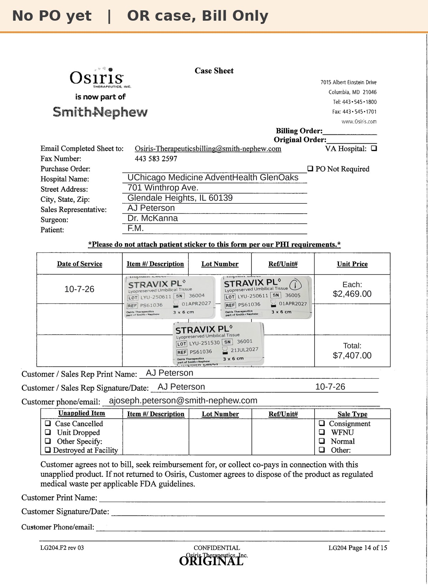

# Case sheet: F.M. 10/7/26

[⬅ Back to tracker](../README.md) · [PDF](./fm-1007.pdf)

**OR case** (not a recurring graft patient) · Bill Only

**Lot/SN**
```
LYU-250611_36004
```
```
LYU-250611_36005
```
```
LYU-251530_36001
```
**PO**
```
none yet
```

| Field | Value |
| --- | --- |
| Date of service | 10/7/26 |
| Patient | F.M. |
| Account | UChicago Medicine AdventHealth GlenOaks (OR) |
| Surgeon | Dr. McKanna |
| Product | Stravix PL 3x6 cm × 3 |
| REF | PS61036 |
| Units | LYU-250611_36004, LYU-250611_36005 (exp 4/1/27); LYU-251530_36001 (exp 7/21/27) |
| Price | $2,469.00 each, $7,407.00 total |
| Status | Waiting on the PO (Bill Only) |
| Note | Case sheet made 10/7 on the 300 DPI template with the real stickers from GlenOaks' implant post case form |


