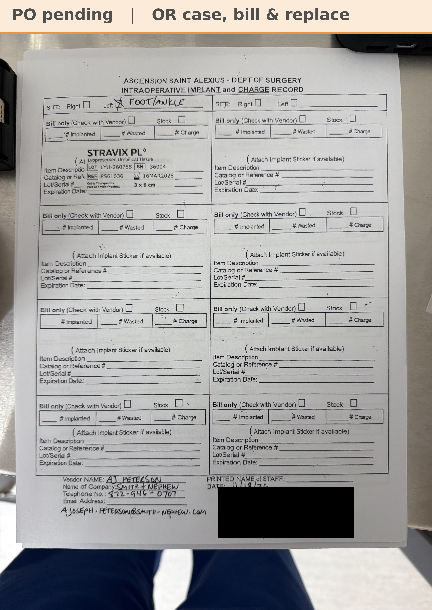

# Implant record: G.D. 11/18/26

[⬅ Back to tracker](../README.md) · [PDF](./gd-1118.pdf)

**OR case** (not a recurring graft patient) · St. Alexius OR shelf, bill & replace

**Lot/SN**
```
LYU-260755_36004
```
**PO**
```
pending
```

| Field | Value |
| --- | --- |
| Date of service | 11/18/26 |
| Patient | G.D. |
| Account | Ascension Saint Alexius (OR) |
| Surgeon | Dr. Adam Bryniczka |
| Site | Left foot/ankle |
| Product | Stravix PL 3x6 cm |
| REF | PS61036 |
| Unit | LYU-260755_36004 (exp 3/16/28) |
| Price | $2,469.00 |
| Status | Waiting on the St. Alexius PO. Bill & replace: a Stravix 3x6 replacement ships to the shelf on the PO |


