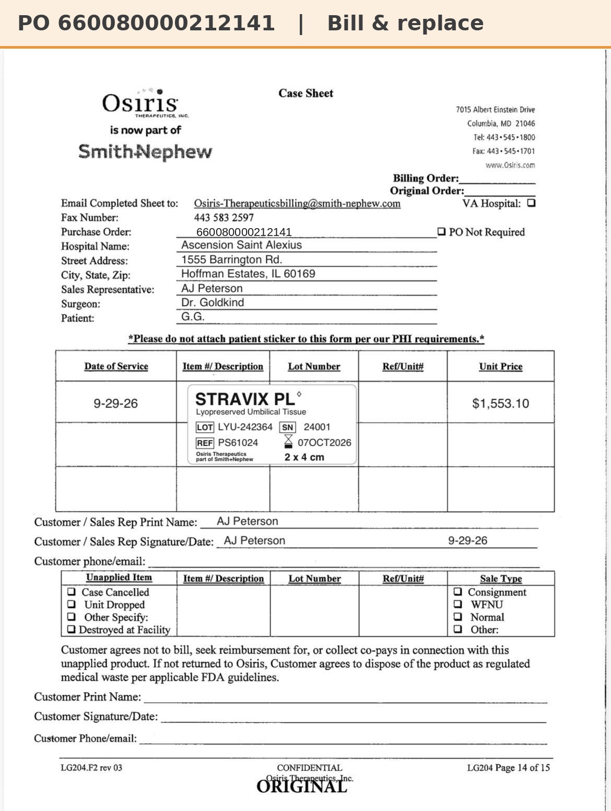

# Case sheet: G.G. 9/29/26

[⬅ Back to tracker](../README.md) · [PDF](./gg-0929.pdf)

**Lot/SN**
```
LYU-242364_24001
```
**PO**
```
660080000212141
```

| Field | Value |
| --- | --- |
| Date of service | 9/29/26 |
| Patient | G.G. |
| Account | Ascension Saint Alexius |
| Surgeon | Dr. Goldkind |
| Product | Stravix PL 2 x 4 |
| REF | PS61024 |
| Lot | LYU-242364 |
| SN | 24001 |
| Price | $1,553.10 |
| Expiry | 10/7/26 |
| Status | Submitted (bill & replace, PO 660080000212141 shipped 10/5) |
| Note | Bill & replace (St. Alexius): replacement Stravix 2x4 shipped 10/5 on PO 660080000212141. SFDC will show the replacement serial |


