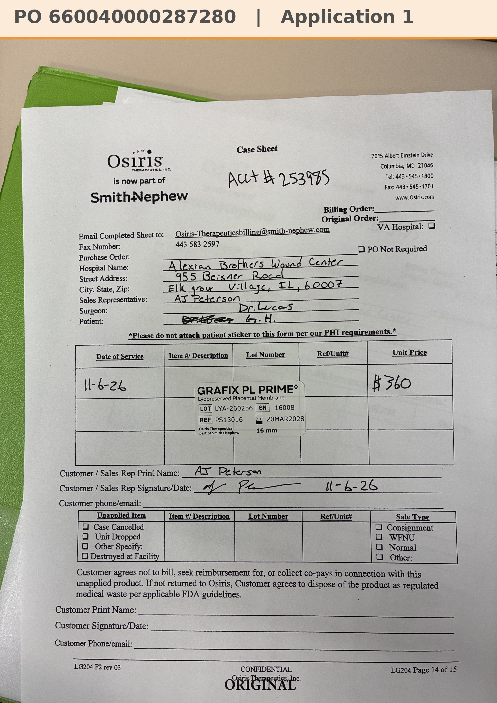

# Case sheet: G.H. 11/6/26

[⬅ Back to tracker](../README.md) · [PDF](./gh-1106.pdf)

**Application #1**

**Lot/SN**
```
LYA-260256_16008
```
**PO**
```
660040000287280
```
**Alexian ID**
```
0003095154
```

| Field | Value |
| --- | --- |
| Date of service | 11/6/26 (12:40 PM) |
| Patient | G.H. |
| Account | Alexian Brothers Wound Center (Acct #253985) |
| Surgeon | Dr. Lucas |
| Product | Grafix PL Prime 16mm disc |
| REF | PS13016 |
| Lot | LYA-260256 |
| SN | 16008 |
| Price | $360 |
| Expiry | 3/20/28 |
| Application | #1 |
| Status | Ready to submit (PO 660040000287280, dated 11/10, received 11/10) |
| Note | AJ's case sheet photo from Chi West 11/6 (first application; new start). From the Alexian WCC shelf. PO 660040000287280 (bill only, matched by patient ID) came in 11/10 and is in the banner. The PO lists the physician as Dr. Ram Ramani; the tracker has Dr. Lucas for this visit (same patient ID, date, size and price). |


