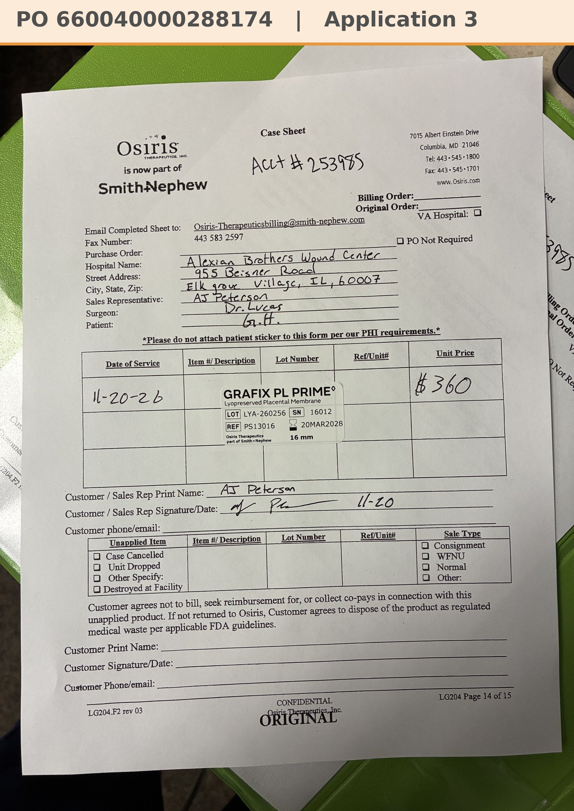

# Case sheet: G.H. 11/20/26

[⬅ Back to tracker](../README.md) · [PDF](./gh-1120.pdf)

**Application #3**

**Lot/SN**
```
LYA-260256_16012
```
**PO**
```
660040000288174
```
**Alexian ID**
```
0003095154
```

| Field | Value |
| --- | --- |
| Date of service | 11/20/26 (12:40 PM) |
| Patient | G.H. |
| Account | Alexian Brothers Wound Center (Acct #253985) |
| Surgeon | Dr. Lucas |
| Product | Grafix PL Prime 16mm disc |
| REF | PS13016 |
| Lot | LYA-260256 |
| SN | 16012 |
| Price | $360 |
| Expiry | 3/20/28 |
| Application | #3 |
| Status | PO 660040000288174 (Ascension bill only, dated 11/20; DOS 11/20, Dr. Lucas, PS13016 16mm $360.00), matched by patient ID and date of service. Ready to submit |
| Note | AJ's case sheet photo from Chi West 11/20 (with the Grafted tap). From the Alexian WCC shelf. |


