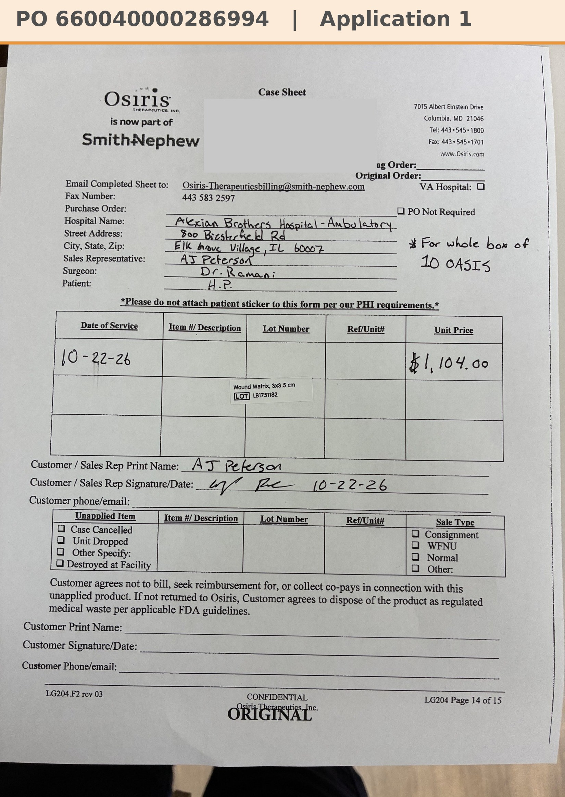

# Case sheet: H.P. 10/22/26

[⬅ Back to tracker](../README.md) · [PDF](./hp-1022.pdf)

**Application #1** (first application) · billed as the whole box of 10

**Lot**
```
LB1751182
```
**PO**
```
660040000286994
```

| Field | Value |
| --- | --- |
| Date of service | 10/22/26 (1:30 PM) |
| Patient | H.P. |
| Account | Alexian Brothers - Ambulatory (Acct #186035) |
| Surgeon | Dr. Ramani |
| Product | OASIS Wound Matrix 3 x 3.5 · 1 box of 10 sheets |
| REF | 8213100033 |
| Lot | LB1751182 |
| Price | $1,104.00 for the box |
| Application | #1 |
| Status | Ready to submit (PO 660040000286994, bill only, dated 11/5, received 11/6; the whole box of 10 at $1,104) |
| Note | Case sheet photo sent 10/27 ("For whole box of 10 OASIS" on the sheet). The hospital patient label is covered on this copy. 9 sheets left in the box for this patient's weekly visits. PO 660040000286994 came in 11/6 and is in the banner |


