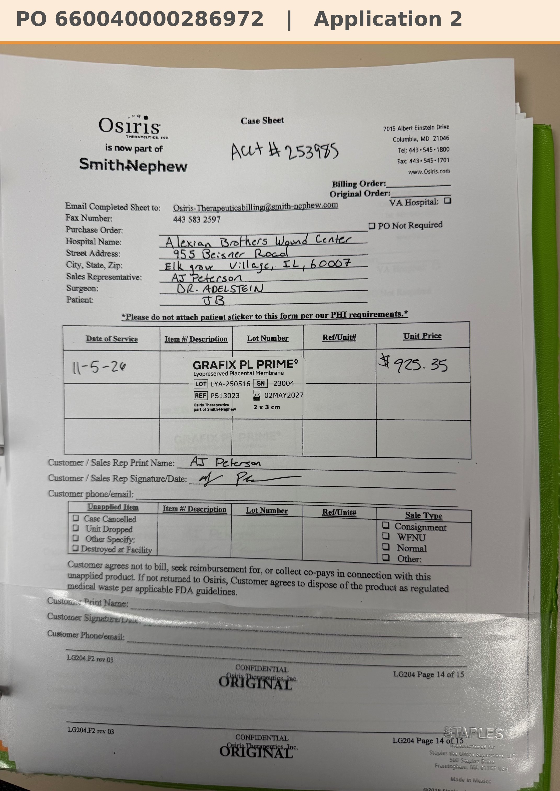

# Case sheet: J.B. 11/5/26

[⬅ Back to tracker](../README.md) · [PDF](./jb-1105.pdf)

**Application #2**

**Lot/SN**
```
LYA-250516_23004
```
**PO**
```
660040000286972
```
**Alexian ID**
```
0002601103
```

| Field | Value |
| --- | --- |
| Date of service | 11/5/26 (8:00 AM) |
| Patient | J.B. |
| Account | Alexian Brothers Wound Center (Acct #253985) |
| Surgeon | Dr. Adelstein |
| Product | Grafix PL Prime 2 x 3 |
| REF | PS13023 |
| Lot | LYA-250516 |
| SN | 23004 |
| Price | $925.35 |
| Expiry | 5/2/27 |
| Application | #2 |
| Status | Ready to submit (PO 660040000286972, bill only, dated 11/5, received 11/6) |
| Note | Case sheet photo uploaded in Chi West 11/5 (A1 was 10/29). From the Alexian WCC shelf. PO 660040000286972 (bill only, by patient ID) came in 11/6 and is in the banner |


