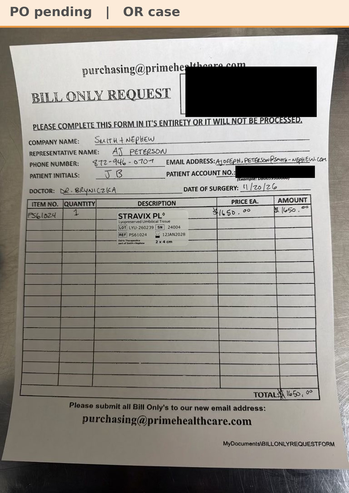

# Case sheet: J.B. 11/20/26

[⬅ Back to tracker](../README.md) · [PDF](./jb-1120.pdf)

**OR case** (not a recurring graft patient) · Bill Only

**Lot/SN**
```
LYU-260239_24004
```
**PO**
```
pending
```

| Field | Value |
| --- | --- |
| Date of service | 11/20/26 (7:30 AM (scheduled case)) |
| Patient | J.B. |
| Account | Saint Joseph Hospital - Elgin (Acct #296620) |
| Surgeon | Dr. Greg Bryniczka |
| Product | Stravix PL 2 x 4 cm |
| REF | PS61024 |
| Lot | LYU-260239 |
| SN | 24004 |
| Price | $1,650 |
| Expiry | 1/12/28 |
| Status | Waiting on the bill-only PO (Prime Healthcare) |
| Note | Bill Only Request photo from AJ 11/20. Patient label and hospital account number covered on this copy |


