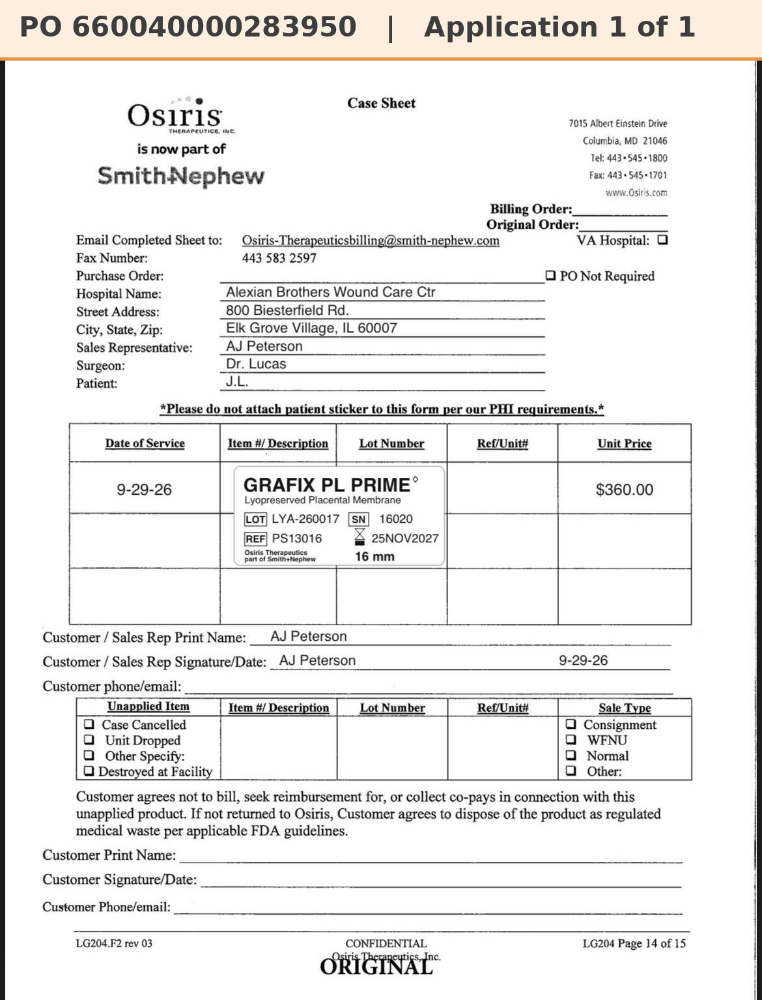

# Case sheet: J.L. 9/29/26

[⬅ Back to tracker](../README.md) · [PDF](./jl-0929.pdf)

**Application #1** of 1 to date (per the 10/2 patient list)

**Lot/SN**
```
LYA-260017_16020
```
**PO**
```
660040000283950
```
**Alexian ID**
```
0003074927
```

| Field | Value |
| --- | --- |
| Date of service | 9/29/26 |
| Patient | J.L. |
| Account | Alexian Brothers Wound Center |
| Surgeon | Dr. Lucas |
| Product | Grafix PL Prime 16mm disc |
| REF | PS13016 |
| Lot | LYA-260017 |
| SN | 16020 |
| Price | $360.00 |
| Expiry | 11/25/27 |
| Application | #1 of 1 to date |
| Status | Not submitted |
| Note | App #1 of 1 (10/2 list). Case sheet on file (initials J.L., not L.J. as on the receiving log). PO by elimination: the other two Lucas 9/29 POs are confirmed to D.G. and T.T. |


