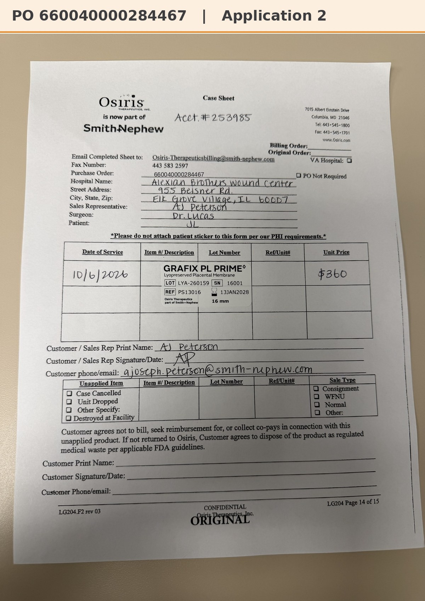

# Case sheet: J.L. 10/6/26

[⬅ Back to tracker](../README.md) · [PDF](./jl-1006.pdf)

**Application #2**

**Lot/SN**
```
LYA-260159_16001
```
**PO**
```
660040000284467
```
**Alexian ID**
```
0003074927
```

| Field | Value |
| --- | --- |
| Date of service | 10/6/26 |
| Patient | J.L. |
| Account | Alexian Brothers Wound Center (Acct #253985) |
| Surgeon | Dr. Lucas |
| Product | Grafix PL Prime 16mm disc |
| REF | PS13016 |
| Lot | LYA-260159 |
| SN | 16001 |
| Price | $360.00 |
| Expiry | 1/13/28 |
| Application | #2 |
| Status | Ready to submit (PO received 10/6) |


