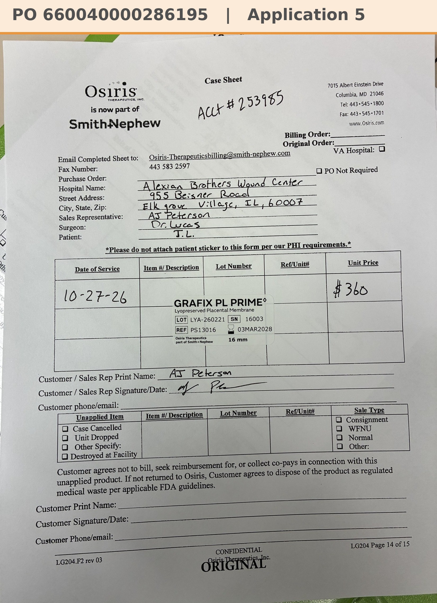

# Case sheet: J.L. 10/27/26

[⬅ Back to tracker](../README.md) · [PDF](./jl-1027.pdf)

**Application #5**

**Lot/SN**
```
LYA-260221_16003
```
**PO**
```
660040000286195
```
**Alexian ID**
```
0003074927
```

| Field | Value |
| --- | --- |
| Date of service | 10/27/26 (9:40 AM) |
| Patient | J.L. |
| Account | Alexian Brothers Wound Center (Acct #253985) |
| Surgeon | Dr. Lucas |
| Product | Grafix PL Prime 16mm disc |
| REF | PS13016 |
| Lot | LYA-260221 |
| SN | 16003 |
| Price | $360.00 |
| Expiry | 3/3/28 |
| Application | #5 |
| Status | Ready to submit (PO 660040000286195, 10/27) |
| Note | Case sheet photo sent 10/27. From the Alexian WCC shelf (10/14 delivery) |


