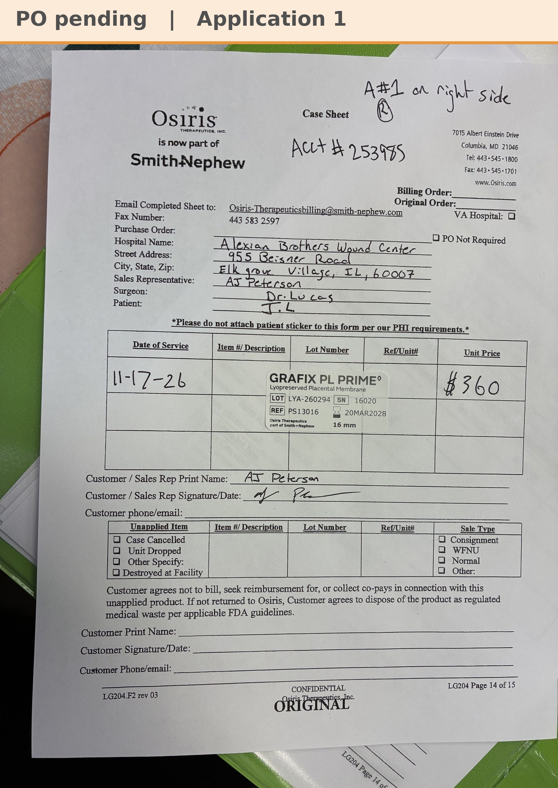

# Case sheet: J.L. 11/17/26

[⬅ Back to tracker](../README.md) · [PDF](./jl-1117.pdf)

**Application #1**

**Lot/SN**
```
LYA-260294_16020
```
**PO**
```
pending
```
**Alexian ID**
```
0003074927
```

| Field | Value |
| --- | --- |
| Date of service | 11/17/26 (9:40 AM) |
| Patient | J.L. |
| Account | Alexian Brothers Wound Center (Acct #253985) |
| Surgeon | Dr. Lucas |
| Product | Grafix PL Prime 16mm disc |
| REF | PS13016 |
| Lot | LYA-260294 |
| SN | 16020 |
| Price | $360 |
| Expiry | 3/20/28 |
| Application | #1 |
| Status | Waiting on the bill-only PO |
| Note | AJ's case sheet photo from Chi West 11/17 (with the Grafted tap). A#1 on the right foot. From the Alexian WCC shelf (11/9 restock). |


